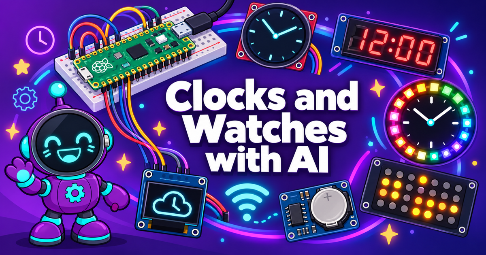

# Designing and Building Clocks and Watches with MicroPython and AI

Welcome to the Clocks and Watches website!

This website is a resource for teachers, mentors and
students who want to have fun hands-on ways to learn computational thinking using
the popular Python language.
This course gives junior high and high school students the tools
to design and build their own digital clocks and smart watches using low-cost components. 

This website contains detailed instructions for finding low-cost parts 
(many under $20/student) and customizing your custom clock and watch displays
using MicroPython.

These projects have only recently been possible due to the following developments:

1. The 2021 release of the powerful $4 Raspberry Pi Pico microcontroller.  
It had almost 100x the power of the Arduino Uno and sold for 1/8th the price.
2. The availability of low-cost high-contrast OLED and TFT displays for as low as [$7 each](https://www.ebay.com/sch/i.html?_nkw=watch+SPI+240x240+display).  When we use the $4 Raspberry Pi Pico our classrooms can create a development system for under $15.
3. The support of highly-optimized drawing of complex ellipse and polygon shapes into the frame buffer by the MicroPython runtime. This only became available in [version 20](https://github.com/micropython/micropython/releases/tag/v1.20.0) of the standard MicroPython runtime released in April of 2023.  Before this every clock and watch project used custom math functions that slowed drawing times.
4. The ability of WiFi-enabled microcontrollers that can synchronize with centralized time services using
standard WiFi networks. We use the $5 Raspberry Pi Pico W in many of our projects.
5. The availability of low-cost yet ultra-precise real-time clock chips like the [DS3231](./glossary.md#ds3231).

Our goal is to provide fun ways to teach computational thinking to a wide variety of students from 6th to 12th grades.  If you can type, we have fun lesson plans from drawing simple shapes to complex clock and watch face designs.

## Acknowledgments

I want to thank everyone in the MicroPython community for sharing their code.  Each of the displays requires MicroPython drivers that have special features to keep drawing fast.  We could not have high-quality lesson plans without your contributions.  If I have not referenced the cool features of your drivers, please let me know!

## Feedback and Comments

If you have any comments or feedback, please feel free to post these to our [GitHub Issues](https://github.com/dmccreary/micropython-watch/issues).  I don't check these issues every day, so please be patient and connect with others
in the MicroPython community if you have urgent questions for a classroom.

Good Luck! - [Dan McCreary on LinkedIn](https://www.linkedin.com/in/danmccreary/)