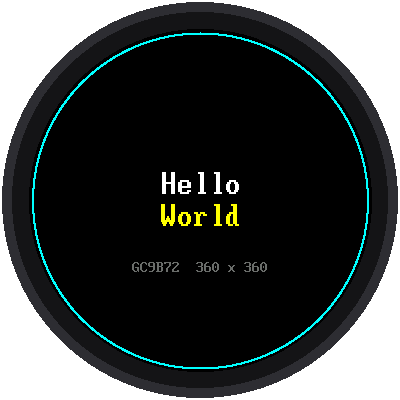

# Lab 04: Hello, Round Screen

{ width="360" }

Time to wake up the screen. This lab writes "Hello World" in the middle
and draws a thin ring just inside the edge of the glass.

!!! mascot-welcome "Welcome to Lab 04"
    { class="mascot-admonition-img" }
    This is the screen every clock face in this kit is drawn on, so once
    it says hello, you're ready to build anything. My own face is a round
    screen just like it! Let's make time tick!

## What You Will Learn

- how to start the display
- how to write centered text in two font sizes
- where the edge of a round screen really is

## Run It

Open `04-display-test.py` and click **Run**. You should see the picture
above. The shell also tells you how long the display took to start.

## The Code

```python
display = config.init_display()

display.fill(config.BLACK)
shapes.ring(display, config.CENTER_X, config.CENTER_Y, config.SAFE_RADIUS,
            config.CYAN, 2)

big = config.BIG_FONT
config.centered_text(display, big, "Hello", config.CENTER_Y - big.HEIGHT,
                     config.WHITE)
config.centered_text(display, big, "World", config.CENTER_Y, config.YELLOW)
config.centered_text(display, config.SMALL_FONT, "GC9B72  360 x 360",
                     config.CENTER_Y + 60, config.GRAY)
```

- `config.init_display()` starts the display using the pins in
  `config.py`.
- `display.fill(config.BLACK)` paints all 129,600 pixels black.
- `shapes.ring(...)` draws a circle 2 pixels thick around the center.
- `config.centered_text(...)` writes words centered left to right. The
  number after the words is how far **down** the screen they go.

## The Round Edge

The display chip thinks its screen is a 360 × 360 square, but the glass
is round. Anything drawn in the corners is never seen. The ring is drawn
at `config.SAFE_RADIUS`, 168 pixels from the center: the biggest circle
you can see all of. The clock faces in labs 08 and 09 place their ticks
from that number.

!!! mascot-tip "Check the ring first"
    { class="mascot-admonition-img" }
    Look closely at the cyan ring. If any part of it hides under the edge
    of your display's case, make `SAFE_RADIUS` in `config.py` a little
    smaller now, and every clock face will fit.

!!! tip "Try This"
    1. Change `config.YELLOW` to `config.color565(255, 128, 0)` for
       orange.
    2. Move the words up by changing `config.CENTER_Y - big.HEIGHT` to
       `config.CENTER_Y - 100`. How high can text go before the round edge
       cuts it off?

## If It Doesn't Work

- **The screen stays black.** Check that SCL goes to GP2 and SDA to GP3:
  swapping them is the most common mistake. Then check VCC on 3V3 and GND.
- **Snow or stripes.** Check RST (GP4), DC (GP5), and CS (GP6). Long or
  messy wires can also do this: set `BAUDRATE` in `config.py` to
  `12_000_000`.

!!! mascot-celebration "Hello, Screen!"
    { class="mascot-admonition-img" }
    You started the display, centered text in two sizes, and found the
    real edge of a round screen. Every clock face from here on is built
    from those same steps.

**Next:** [Lab 05: Test the Speaker](05-speaker-test.md)
