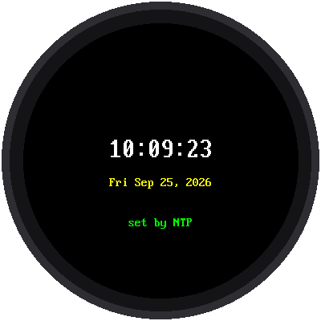

# Lab 07: Get the Time

{ width="360" }

This lab asks a time server on the internet for the exact time, sets the
Pico's clock with it, and shows the time on the screen and in the shell
every second.

!!! mascot-welcome "Welcome to Lab 07"
    { class="mascot-admonition-img" }
    This is the moment the kit becomes a real clock. Somewhere out there,
    servers keep time to a tiny fraction of a second, and you're about to
    borrow it. Every second counts! Let's make time tick!

## What You Will Learn

- why the Pico W doesn't know the time when it starts
- how **NTP** sets the clock
- why time servers send **UTC**, and how the time zone fixes it

## Run It

Open `07-get-time.py` and click **Run**. The screen says "Getting time",
shows each step, and then the time:

```text
07-get-time.py v1.0
Joining MyHomeWiFi
IP 10.0.0.99
Asking pool.ntp.org
Time set 10:09:20
Clock set from pool.ntp.org
Fri Sep 25, 2026 10:09:20
Fri Sep 25, 2026 10:09:21
Fri Sep 25, 2026 10:09:22
```

## Why Ask the Internet?

The Pico W has a clock inside, but no battery to keep it running. Every
time it powers up, its clock starts over at a date in the past. So the
kit's `wifi_time.sync_time()` does four things:

1. joins the network in `secrets.py`
2. asks `pool.ntp.org` for the time
3. adds your time zone, plus an hour in summer if `USE_US_DST` is `True`
4. sets the Pico's clock and turns WiFi off again

After that, `time.localtime()` gives the right local time with no network
at all.

!!! mascot-thinking "One time for the whole world"
    { class="mascot-admonition-img" }
    A time server talks to devices in every time zone, so it can't send
    *your* time. It sends **UTC**, the time at zero degrees longitude, and
    every device adds its own offset. That's what `TIMEZONE_HOURS` is for.

## Redraw Without Flicker

The loop only redraws when the second changes, and it always writes text
of the same width, so each new time exactly covers the last one. Nothing
is erased first, so nothing flickers.

```python
clock = "{:02d}:{:02d}:{:02d}".format(hour, minute, second)
config.centered_text(display, config.BIG_FONT, clock, 150)
```

`{:02d}` means "at least two digits, with a leading zero", so 9 becomes
`09` and the width never changes.

!!! tip "Try This"
    1. Set `TIMEZONE_HOURS` in `config.py` to `0`. Now the clock shows UTC,
       the time the server really sent.
    2. Make a 12-hour clock: use `(hour % 12 or 12)` instead of `hour`, and
       add `"AM"` if `hour < 12`, otherwise `"PM"`.

## If It Doesn't Work

- **"NOT synced" in red.** The clock couldn't reach the time server. Run
  [Lab 06](06-test-wifi.md) to find out why.
- **The time is off by exactly an hour.** Check `USE_US_DST` in
  `config.py`.
- **Off by several hours.** Check `TIMEZONE_HOURS`.

!!! mascot-celebration "Right on Time!"
    { class="mascot-admonition-img" }
    Your clock set itself from the internet, turned UTC into your local
    time, and updates every second without flicker. All seven parts of
    the kit are tested, so now it's time to build the real clock.

**Next:** [Lab 08: The Big Clock](08-big-clock.md)
