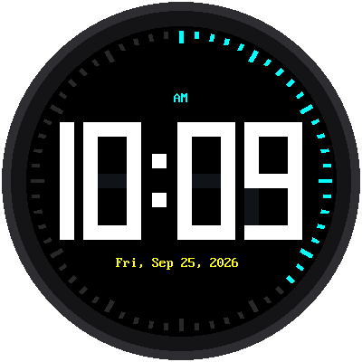

# Lab 08: The Big Clock

{ width="360" }

All the parts work. Now put them together: the biggest digits the round
screen can hold, a ring of 60 ticks that counts the seconds, and a chime
at the top of every hour. This is `main-template.py`, a clock you can
leave running on your desk.

!!! mascot-welcome "Welcome to Lab 08"
    { class="mascot-admonition-img" }
    You can read this clock from across the room, and it chimes to tell
    you the hour. By the end of this lab it will start by itself every
    time you plug it in. Let's make time tick!

## What You Will Learn

- how to fit the biggest rectangle inside a circle
- how digits are built from seven bars
- how a program plays sound while it keeps the time

## Run It

Open `main-template.py` and click **Run**. The clock joins WiFi, sets its
time, plays a short start-up sound, and shows the time.

| Button | What it does |
|---|---|
| **UP** / **DOWN** | Volume up or down, with a beep at the new volume. Hold to keep changing. |
| tap **MODE** | Turns the hourly chime on or off |
| hold **MODE** | Sets the clock from the internet right now |

## Make It Start by Itself

When a Pico powers up, it runs the file called `main.py`. Copy the clock
there:

```bash
mpremote cp main-template.py :main.py
```

Now unplug the Pico and plug it back in. It starts as a clock.

## Digits Made of Bars

Each digit is a **seven-segment** digit, like the ones on a microwave:
seven bars, each one either lit or not. The `8` lights all seven, and the
`1` lights two. The unlit bars are drawn in a very dark gray, so you can
see faint "ghost" segments behind every digit.

## How Big Can the Digits Be?

A round screen is widest across the middle and narrower above and below.
The row of digits is a rectangle, and its **corners** are what bump into
the round edge first.

!!! mascot-thinking "A rectangle inside a circle"
    { class="mascot-admonition-img" }
    A corner of the digit row is half its width across and half its
    height up from the center. By the Pythagorean theorem, that corner
    stays inside a circle of radius 150 when
    (width ÷ 2)² + (height ÷ 2)² is less than 150².

Here the corners are 134 pixels across and 65 pixels up:
134² + 65² = 22,181, just under 150² = 22,500. It just fits.

On a 12-hour clock the first digit is only ever 1 or blank, so the clock
draws it as half a digit and gives the room it saves to the other three.

## Sound and Time Together

Playing a sound means sending samples to the amplifier without a break.
The kit's `sound.py` does that from the Pico's **second core**, the
second processor inside the chip, so the first core can keep drawing the
clock. The clock asks for a sound by name:

```python
if chime_on and minute == 0 and not quiet:
    speaker.play("chime")
```

`quiet` is `True` from 10 PM until 7 AM, so the chime never wakes anyone
up.

The Pico's own clock drifts a second or two a day, so every night at
3:00 AM the clock sets itself from the internet again.

!!! tip "Try This"
    1. Set `TWELVE_HOUR = False` for a 24-hour clock. Why do the digits get
       smaller?
    2. Change `GHOST` to `config.BLACK` to hide the unlit bars.
    3. Change `"chime"` to `"doorbell"` or `"bird"`. `sfx.py` has more
       sounds to try.
    4. Change `QUIET_START` and `QUIET_END` to match when your family
       sleeps.

## If It Doesn't Work

- **`MemoryError` when the sound starts.** Unplug the Pico and plug it
  back in, so it starts with fresh memory. If you changed the program,
  keep `speaker.start()` where it was: the sound needs one unbroken 4 KB
  block of memory, so it starts before the face is built.
- **No chime on the hour.** Is the chime on? Tap MODE and read the note
  under the digits. Remember it stays quiet from 10 PM to 7 AM.
- **The time is wrong.** Run [Lab 07](07-get-time.md) to check the
  internet time.

!!! mascot-celebration "A Clock You Built!"
    { class="mascot-admonition-img" }
    You fit the biggest digits a circle can hold, and your clock chimes
    while it keeps time. Put it on your desk: it sets itself every night
    from now on.

**Next:** [Lab 09: One Clock, Ten Modes](09-ten-modes.md)
