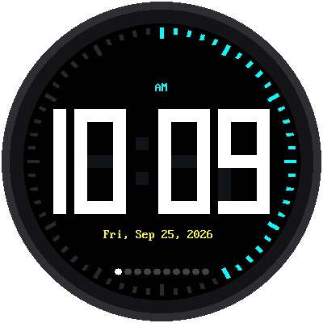
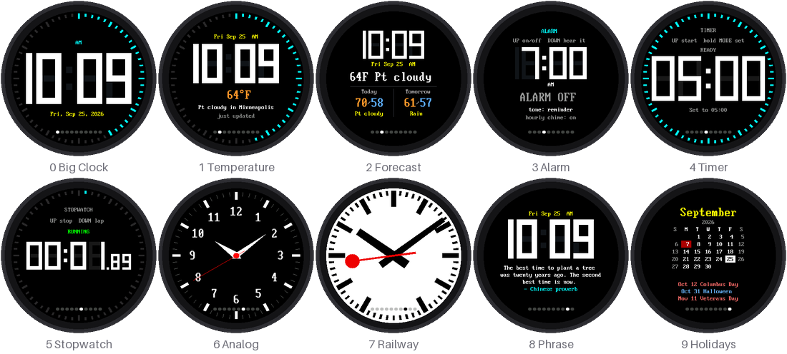
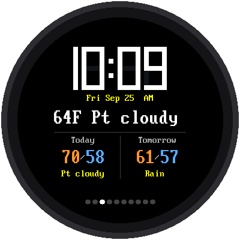
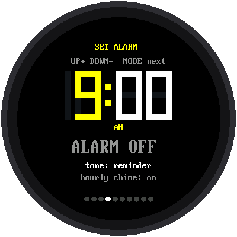
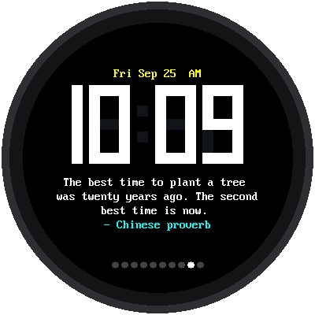
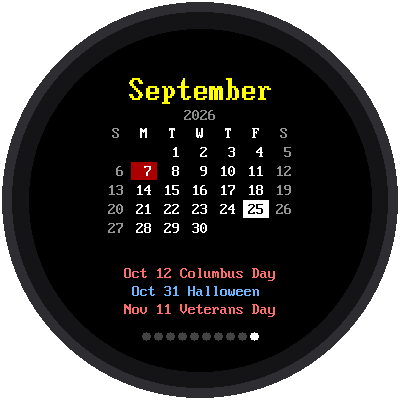

# Lab 09: One Clock, Ten Modes

{ width="360" }

`mode-template.py` puts ten clock faces in one program. Tap **MODE** to go
to the next one. A row of ten dots along the bottom shows which mode you
are in. It starts in the Big Clock.

!!! mascot-welcome "Welcome to Lab 09"
    { class="mascot-admonition-img" }
    This is the finished clock: weather, an alarm, a timer, a stopwatch,
    a railway clock, and a holiday calendar, all behind one button. Each
    mode is its own small file, so you can change one, or add your own.
    Let's make time tick!

## What You Will Learn

- how one program can switch between many faces
- why a small computer loads only one face at a time
- how the alarm and timer can interrupt whatever mode is showing

## Run It

Open `mode-template.py` and click **Run**. To make it start at power-up
instead of the Big Clock:

```bash
mpremote cp mode-template.py :main.py
```

## The Ten Modes

| Dot | Mode | UP / DOWN | Hold MODE |
|---|---|---|---|
| 0 | Big Clock | volume | set the clock from the internet |
| 1 | Time + temperature | UP: get the weather now | set the clock from the internet |
| 2 | Time + temperature + forecast | UP: get the weather now | set the clock from the internet |
| 3 | Alarm | UP: alarm on/off, DOWN: hear the tone | set the alarm |
| 4 | Timer | UP: start/pause, DOWN: reset | set the time |
| 5 | Stopwatch | UP: start/stop, DOWN: lap or reset | set the clock from the internet |
| 6 | Analog watch | — | set the clock from the internet |
| 7 | Railway clock | — | set the clock from the internet |
| 8 | Phrase of the day | other phrases | set the clock from the internet |
| 9 | US holiday calendar | next / previous month | set the clock from the internet |



### 1 and 2: Weather

{ width="260" }

Modes 1 and 2 show the temperature outside, and mode 2 adds the high,
low, and weather for today and tomorrow. The forecast comes from
[Open-Meteo](https://open-meteo.com), a free weather service that needs
no account. It uses `LATITUDE` and `LONGITUDE` from `config.py`, and
fetches new weather every 30 minutes.

### 3: Alarm

{ width="260" }

Hold MODE to set the alarm. The part you are setting turns yellow. Use UP
and DOWN to change it, and tap MODE for the next part: hour, minute,
tone, alarm on or off, and the hourly chime. While you are setting it,
MODE belongs to the alarm, so a tap can't switch modes by accident.

When the alarm time comes, the clock switches to this screen from any
mode and rings. Any button stops it.

### 4 and 5: Timer and Stopwatch

The timer counts down and beeps at zero, even if you've switched to
another mode. The stopwatch keeps running too: it remembers when it
started, so the time is still right when you come back.

### 6 and 7: Analog and Railway

Mode 6 is the analog watch face from the
[Chrono Smart Clock Kit](../sw-gc9b72/05-analog-watch-face.md). Mode 7 is
the Swiss station clock from the
[Railway Clock Kit](../mondaine/index.md), whose red second hand waits at
12 every minute.

### 8: Phrase of the Day

{ width="260" }

A new phrase every day, picked by the day of the year, so everyone with
this kit sees the same one on the same day. UP and DOWN show other
phrases.

Lines of text get shorter toward the bottom of a round screen, so the
mode works out how many letters fit on each row and fills the rows one
word at a time.

### 9: Holiday Calendar

{ width="260" }

Today has a white box. Federal holidays are red, and other holidays are
blue. Under the grid are the next three holidays.

Most holidays don't have a fixed date. Thanksgiving is "the fourth
Thursday in November." So `holidays.py` keeps the **rules** and works out
the dates for any year. The calendar never runs out.

## Only One Mode at a Time

The Pico W has about 190 KB of memory for Python, and all ten faces
together would not fit. So when you tap MODE, the program:

1. asks the current mode to `stop()`, and keeps what it hands back
2. removes that mode from memory and tidies up the free space
3. loads the next mode fresh and calls its `start()`

!!! mascot-thinking "Small computers, small backpacks"
    { class="mascot-admonition-img" }
    Think of the Pico as carrying one textbook at a time. It puts one
    back on the shelf before taking the next. Things every mode needs,
    like the alarm time and the volume, stay in `shared.py`, which never
    goes back on the shelf.

That's also how the alarm and timer interrupt you. The main program, not
any one mode, checks the alarm once a minute. A running timer hands back
the moment it will finish when you leave it, and the main program
switches back to it right then.

## Every Mode Has the Same Functions

`mode-template.py` only knows four things about a mode:

| Function | What it does |
|---|---|
| `start(display, up, down, saved)` | Draw the whole screen |
| `update(now)` | Called over and over: read UP and DOWN, redraw what changed |
| `on_mode(kind)` | Optional: use a MODE press (short or long) for itself |
| `stop()` | Turn things off, and hand back anything to remember |

So an eleventh mode is just one more file with those functions. The top
of `mode-template.py` explains how to add it.

!!! tip "Try This"
    1. Set `DEMO_SECONDS = 8` in `mode-template.py`. The clock steps
       through the modes by itself, like a display in a shop window.
    2. Add your own phrase to the list in `mode_phrase.py`.
    3. Make an eleventh mode: copy `mode_big.py` to `mode_mine.py`,
       change its colors, and add `("mode_mine", "Mine")` to `MODES` in
       `mode-template.py`. Is there room for eleven dots?

## If It Doesn't Work

- **No weather.** Check that [Lab 06](06-test-wifi.md) passes, then check
  `LATITUDE` and `LONGITUDE` in `config.py`. Press UP in mode 1 to try
  again.
- **`MemoryError` when you change modes.** Unplug the Pico and plug it
  back in, so it starts with fresh memory. If you changed a mode, check
  that its `stop()` turns off everything it started.
- **The alarm didn't ring.** Is it on? Mode 3 shows ALARM ON or ALARM OFF.

!!! mascot-celebration "Ten Clocks in One!"
    { class="mascot-admonition-img" }
    You've run a program that loads one mode at a time and still keeps
    the alarm and timer working in the background. You know the four
    functions every mode needs, so you can build the eleventh.

**Back to:** [Big Round Speaker Clock Kit](index.md)
