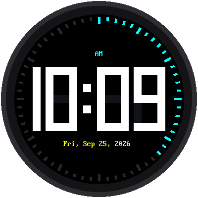
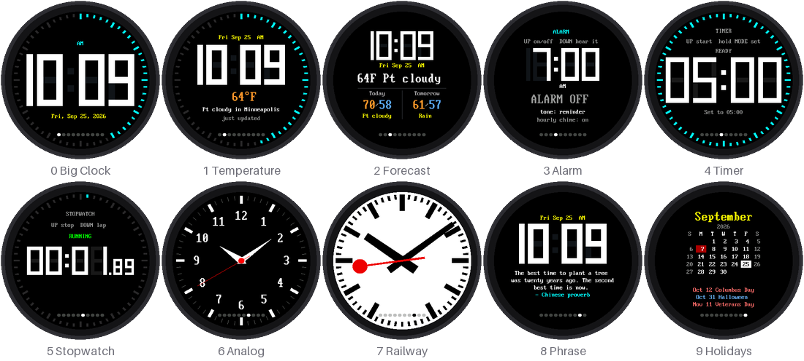
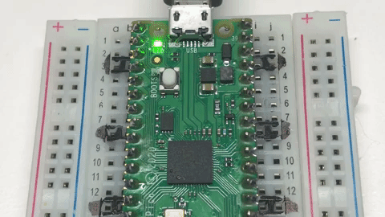
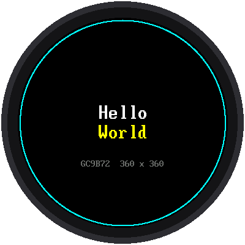
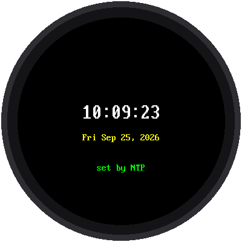
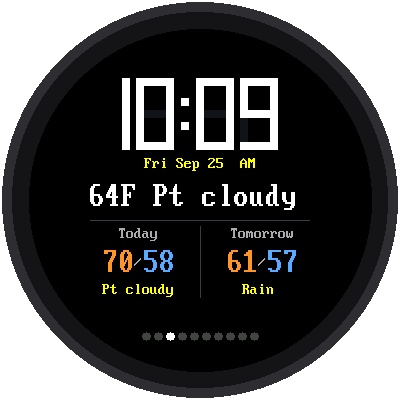

# Big Round Speaker Clock Kit

**A clock with giant digits, ten different faces, and a speaker that
chimes, beeps and wakes you up.**

{ width="360" }

This kit takes the round screen from the
[Chrono Smart Clock Kit](../sw-gc9b72/index.md) and adds a voice: a tiny
amplifier board and a speaker. Your clock can chime on the hour, ring an
alarm in the morning, and beep when a timer runs out. It sets its own time
from the internet, and one button flips it between ten faces.

**No soldering. No experience needed.**

!!! mascot-welcome "Meet the Speaker Clock"
    { class="mascot-admonition-img" }
    Until now, my clocks could only show you the time. This one can *tell*
    you, with a chime on the hour and an alarm that gets you out of bed.
    By the last lab, you'll have ten clock faces in one program, and every
    one of them is yours to change. Let's make time tick!

## What Your Clock Will Do

- **Show the biggest digits that fit.** The Big Clock fills the round
  screen with four giant numbers and a ring of ticks that counts the
  seconds.
- **Make sound.** It chimes on the hour (but not at night), rings an alarm,
  and beeps when a countdown ends.
- **Set its own time.** It asks the internet what time it is when it
  starts, and again every night at 3:00 AM.
- **Tell you the weather.** Two faces show the temperature outside and the
  forecast for today and tomorrow.
- **Do ten jobs.** Tap MODE to step through all ten faces.

## How It Works

There are nine labs. The first seven are short tests. Each one checks
**one** part of the kit, so if something is wired wrong you find out
exactly which part. The last two are the finished clocks.

1. **Check the parts (labs 01–05).** Blink a light, give the board a
   checkup, and test the buttons, the screen, and the speaker one at a
   time.
2. **Connect to the internet (labs 06–07).** Check your WiFi settings,
   then set the clock from a time server.
3. **Build the clock (labs 08–09).** Run the Big Clock, then the full
   clock with ten modes.

## What's in the Kit

| Part | What it does |
|---|---|
| **Raspberry Pi Pico W** | The brain. A *microcontroller* (a tiny computer on a board) with WiFi. This kit is set up for the original Pico W. |
| **Round color display** | The clock face: 2.1 inches across, 360 × 360 **pixels**. A chip on the back called the **GC9B72** turns the Pico's messages into pictures. |
| **MAX98357A amplifier board** | Turns the Pico's sound data into a signal strong enough to drive a speaker. It is only an amplifier: it has **no microphone**. |
| **Small speaker** | Plays the chimes, beeps, and alarms. |
| **Three push buttons** | **MODE**, **UP**, and **DOWN**. |
| **Breadboard, wires, and a USB cable** | Connect everything without soldering, and power the Pico. |

## How It Is Wired

All the pin numbers live in one file, `config.py`, so every program uses
the same ones.

**The display** uses the same pins as the Chrono Smart Clock Kit:

| Display pin | Pico pin | What it carries |
|---|---|---|
| GND | GND | Ground |
| VCC | 3V3 | Power, 3.3 volts |
| SCL | GP2 | The clock beat for the data |
| SDA | GP3 | The data: the colors of the pixels |
| RST | GP4 | Reset |
| DC | GP5 | Command or picture? |
| CS | GP6 | "Display, I'm talking to you" |
| BL | GP7 | The backlight |

**The amplifier** gets its sound on three wires, plus one that sets how
loud it is:

| Amplifier pin | Pico pin | What it carries |
|---|---|---|
| BCLK | GP9 | The bit clock: one tick for every bit of sound |
| LRC | GP10 | Left or right? (This kit uses one speaker.) |
| DIN | GP11 | The sound itself |
| GAIN | GP12 | How much the amplifier boosts the sound |
| SD | not connected | The amplifier stays on |
| VIN | VBUS (5 V) or 3V3 | Power for the amplifier |
| GND | GND | Ground |

The speaker's two wires go into the amplifier's **+** and **−** terminals.

**The buttons** each have one leg on a Pico pin and the other on GND:

| Button | Pico pin |
|---|---|
| MODE | GP13 |
| UP | GP14 |
| DOWN | GP15 |

!!! mascot-warning "Two wires that must be in order"
    { class="mascot-admonition-img" }
    The Pico's sound hardware needs **LRC on the pin right after BCLK**:
    GP9 then GP10. Swap those two wires and the sound programs stop with
    an error before making a single beep. If that happens, check the wiring
    first, and swap them back.

The display's VCC goes to **3V3**, never to VBUS or VSYS. The amplifier
is different: it is happy on either 5 volts (VBUS) or 3.3 volts.

## Before You Start

You only need to do these steps once.

1. **Put MicroPython on the Pico.** Download the
   [Pico W version](https://micropython.org/download/RPI_PICO_W/). The
   version for the plain Pico has no WiFi.
2. **Install [Thonny](https://thonny.org)**, the program you use to write
   code and send it to the Pico.
3. **Copy the kit onto the Pico.** The kit folder has a script called
   `upload-code.sh` that copies the `lib` folder, `config.py`, the labs,
   and the clock programs. Close Thonny before you run it. Your teacher
   may have done this for you.
4. **Tell the clock about your WiFi.** Copy `secrets-template.py` to a new
   file called `secrets.py` and type in your network's name and password.
   (`secrets.py` is never shared online.)
5. **Tell the clock where you are.** In `config.py`, set `TIMEZONE_HOURS`
   (−5 Eastern, −6 Central, −7 Mountain, −8 Pacific), `USE_US_DST`, and
   `CITY`, `LATITUDE`, and `LONGITUDE` for the weather.

## The Labs

| Lab | | What you will do |
|---|---|---|
| [01](01-blink-onboard-led.md) | [{ width="110" }](01-blink-onboard-led.md) | Blink the light on the Pico, to check the board works |
| [02](02-probe.md) | | Give the whole kit a checkup |
| [03](03-button-test.md) | | Test the three buttons |
| [04](04-display-test.md) | [{ width="110" }](04-display-test.md) | Say hello on the round screen |
| [05](05-speaker-test.md) | | Play a tone through the speaker |
| [06](06-test-wifi.md) | | Check your WiFi settings |
| [07](07-get-time.md) | [{ width="110" }](07-get-time.md) | Set the clock from the internet |
| [08](08-big-clock.md) | [{ width="110" }](08-big-clock.md) | Run the Big Clock, with an hourly chime |
| [09](09-ten-modes.md) | [{ width="110" }](09-ten-modes.md) | One clock, ten modes |

!!! mascot-tip "Which program is running?"
    { class="mascot-admonition-img" }
    Every program prints its name and version in Thonny's shell when it
    starts, like `05-speaker-test.py v1.0`. If the clock isn't doing what
    you expect, read that line first.

## Words to Know

| Word | What it means |
|---|---|
| **Pixel** | One tiny dot of light on the screen. |
| **Amplifier** | A circuit that makes a weak signal strong enough to move a speaker. |
| **Sample** | One number that says where the speaker cone should be at one instant. This kit plays 16,000 of them every second. |
| **I2S** | The three-wire way the Pico sends sound samples to the amplifier. Say it "eye-squared-ess." |
| **NTP** | Network Time Protocol: how a device asks a time server on the internet what time it is. |
| **Mode** | One face of the clock. MODE switches between them. |
| **Debounce** | Ignoring the extra flickers a button makes when its metal contacts touch. |

## For Teachers

The [Notes for Teachers](teacher-notes.md) page covers the hardware
details, how the sound works, memory on the Pico W, and a troubleshooting
table. The screen pictures in these pages come from running each program's
real code in a simulator of the display. The simulator has no speaker, so
the sound in these labs has only been heard on the real kit.
