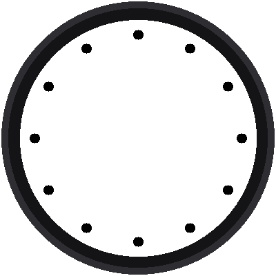
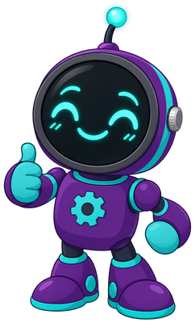

# Lab 02: Twelve Dots in a Circle

{ width="360" }

A clock face is a circle with things placed around it at equal steps.
This lab places twelve black dots, one for each hour. It's a small
program, but it hides the most useful trick in the whole kit: turning an
**angle** into a spot on the screen.

!!! mascot-welcome "Welcome to Lab 02"
    { class="mascot-admonition-img" }
    After this lab you can place anything at any angle around a circle.
    That's how every hand, every bar, and every dot on this clock gets
    where it's going. Let's make time tick!

## What You Will Learn

- what a **variable** is
- how a **for loop** repeats work
- how **sine** and **cosine** turn an angle into x and y

## Run It

Open `02-dial-dots.py` in Thonny and click **Run**. Twelve dots appear
around the screen, and Thonny's shell prints a line for each one:

```
hour 0 angle 0 dot at 180 30
hour 1 angle 30 dot at 255 50
hour 2 angle 60 dot at 310 105
```

The first dot is at the top, at x = 180 and y = 30. Then the dots march
clockwise.

## Variables: Names for Numbers

The program gives a few numbers names, so the rest of the code can use
the names:

```python
DISTANCE = 150      # how far each dot sits from the center, in pixels
DOT_RADIUS = 7
```

If you want the dots farther out, you change one number in one place.
That is why programmers use variables.

## The For Loop

```python
for hour in range(12):
    degrees = hour * 30
    ...
```

`range(12)` counts 0, 1, 2, ... 11, twelve numbers. The loop runs the
indented lines once for each number, and the variable `hour` holds the
current one. A full circle is 360 degrees, and 360 ÷ 12 = 30, so each hour
is 30 degrees farther around than the one before.

## From an Angle to a Spot

A clock measures angles from 12 o'clock, going clockwise. Two math tools
turn an angle into a position:

```python
x = round(CENTER_X + DISTANCE * math.sin(angle))
y = round(CENTER_Y - DISTANCE * math.cos(angle))
```

Why the minus sign on y? Remember from [lab 01](01-hello-display.md) that
y grows *downward*. The minus flips it, so angle 0 points up at the 12.

!!! mascot-thinking "Sine and Cosine in One Sentence"
    { class="mascot-admonition-img" }
    Think of standing at the center and walking `DISTANCE` steps toward a
    direction. Sine tells you how far you ended up *across*, and cosine
    tells you how far *up*, as fractions of your steps.

One more detail: `sin()` and `cos()` want the angle in **radians**, not
degrees, so `math.radians()` converts it first. `round()` turns the result
into a whole number of pixels, since there's no such thing as half a
pixel.

!!! mascot-encourage "Strange-Looking Math?"
    { class="mascot-admonition-img" }
    Most people don't meet sine and cosine until high school, so if they
    feel strange, that's normal. You already placed things by x and y in
    lab 01, and these two tools just turn an angle into an x and a y.

!!! tip "Try This"
    1. Change `range(12)` to `range(60)` and `hour * 30` to `hour * 6`.
       Now there's a dot for every minute.
    2. Change `DISTANCE` to `100`. Where do the dots go?
    3. Make every third dot red. (Hint: `if hour % 3 == 0:`. You'll meet
       `%` in lab 04.)

!!! mascot-celebration "A Circle of Dots!"
    { class="mascot-admonition-img" }
    You used a for loop, sine, and cosine to place twelve dots at exact
    angles. Next, you'll turn those dots into the bold bars of a Swiss
    railway clock.

**Next:** [Lab 03: Twelve Bars](03-hour-markers.md)
