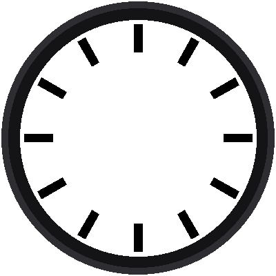

# Lab 03: Twelve Bars

{ width="360" }

A Swiss railway clock has no numbers. Its twelve hours are marked by
heavy black bars, easy to read from across a train platform. This lab
draws them. To do it, you write your first **functions**.

!!! mascot-welcome "Welcome to Lab 03"
    { class="mascot-admonition-img" }
    Last lab you drew dots. Now you'll draw rectangles that point at the
    center from any direction, which is the shape of every bar and every
    hand on this clock. Let's make time tick!

## What You Will Learn

- how to write your own **function** with `def`
- how a **design unit** lets a whole drawing grow or shrink at once
- how to draw a filled shape from its corners

## Run It

Open `03-hour-markers.py` in Thonny and click **Run**. Twelve black bars
appear around the dial, each one pointing at the center.

## One Unit to Measure Everything

The railway clock was designed so that every size is a multiple of one
small unit, called **a**. One *a* is 1/100 of the dial's width. The
program says how many pixels that is:

```python
A = 3.4      # one design unit, in pixels (the dial is 100 a across)
```

Now a five-minute bar is described like this:

| Part of the bar | Size in *a* | Pixels (A = 3.4) |
|---|---|---|
| Starts this far from the center | 36.5 | about 124 |
| Ends this far from the center | 48.5 | about 165 |
| Half of its width | 1.75 | about 6 |

!!! mascot-thinking "Change One Number, Change Everything"
    { class="mascot-admonition-img" }
    Because every size is a multiple of *a*, the whole face is one
    picture that you can scale. Try `A = 3.0` and the face shrinks. The
    bars keep their proportions, and the design stays the same.

## Your First Functions

A **function** is a named set of instructions you can use again and again.
This program has two. The first, `point()`, is lab 02's sine-and-cosine
math in a box:

```python
def point(angle, along, across=0):
    a = math.radians(angle)
    x = CENTER_X + along * math.sin(a) + across * math.cos(a)
    y = CENTER_Y - along * math.cos(a) + across * math.sin(a)
    return round(x), round(y)
```

You give it an angle, how far *along* that direction to walk, and
(optionally) how far to step *across*, sideways. It gives back the
screen position. The sideways step is new: it's what lets us find a
rectangle's corners.

The second function, `bar()`, finds all four corners and fills them in:

```python
def bar(display, angle, inner, outer, half_width, color):
    x0, y0 = point(angle, inner, -half_width)
    x1, y1 = point(angle, outer, -half_width)
    x2, y2 = point(angle, outer, half_width)
    x3, y3 = point(angle, inner, half_width)
    corners = array('h', [x0, y0, x1, y1, x2, y2, x3, y3])
    shapes.poly(display, 0, 0, corners, color, config.FILL)
```

Each corner is a step along the bar's direction, then a step to the left
(a negative `across`) or right. The `shapes.poly()` helper fills the
four-cornered shape with color.

With the functions written, drawing all twelve bars takes three lines:

```python
for hour in range(12):
    bar(display, hour * 30, 36.5 * A, 48.5 * A, 1.75 * A, config.BLACK)
```

!!! mascot-tip "Name Things for the Next Reader"
    { class="mascot-admonition-img" }
    A function name like `bar()` tells you what it does without reading
    it. When your code is full of descriptive names, you can come back to
    it a month later and still understand it.

!!! tip "Try This"
    1. Change `A = 3.4` to `A = 2.5`. What happens to the bars?
    2. Make the bars red by changing `config.BLACK` to `config.RAIL_RED`.
    3. Change `1.75 * A` to `3 * A` to make the bars fat.

!!! mascot-celebration "Twelve Bars Done!"
    { class="mascot-admonition-img" }
    You wrote two functions and used them to draw twelve rotated
    rectangles from one design unit. Next, you'll add the 48 small bars
    between them.

**Next:** [Lab 04: Sixty Bars](04-minute-markers.md)
