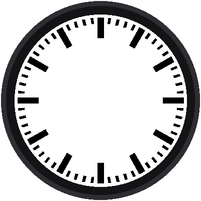

# Lab 04: Sixty Bars

{ width="360" }

Between each pair of heavy hour bars sit four little minute bars. In all,
there are 60 bars: 12 big and 48 small. One loop draws them all, and one
small `if` decides how big each one is.

!!! mascot-welcome "Welcome to Lab 04"
    { class="mascot-admonition-img" }
    This is the lab where your dial looks like a real railway clock. You'll
    also learn how a program makes a decision. Let's make time tick!

## What You Will Learn

- what the **remainder** operator `%` does
- how an **if / else** chooses between two things
- how one loop can draw sixty different things

## Run It

Open `04-minute-markers.py` in Thonny and click **Run**. The dial fills
in: every fifth bar is big and bold, and the rest are small.

## The Remainder

Dividing 7 by 5 gives 1 with 2 left over. The `%` operator gives you that
leftover:

```python
7 % 5      # 2
10 % 5     # 0
```

Look at what `minute % 5` does as the minute counts up:

| minute | 0 | 1 | 2 | 3 | 4 | 5 | 6 | 7 | 8 | 9 | 10 |
|---|---|---|---|---|---|---|---|---|---|---|---|
| `minute % 5` | **0** | 1 | 2 | 3 | 4 | **0** | 1 | 2 | 3 | 4 | **0** |

It is 0 exactly on every fifth minute, which is where the big bars go.

!!! mascot-tip "Print the Pattern First"
    { class="mascot-admonition-img" }
    Not sure what a loop will do? Add `print(minute, minute % 5)` inside it
    and read Thonny's shell before you draw anything. Seeing the numbers
    makes the pattern obvious.

## If and Else

```python
for minute in range(60):
    angle = minute * 6
    if minute % 5 == 0:
        bar(display, angle, 36.5 * A, 48.5 * A, 1.75 * A, config.BLACK)
    else:
        bar(display, angle, 45.0 * A, 48.5 * A, 0.7 * A, config.BLACK)
```

Read it out loud: *if the remainder is 0, draw a big bar, otherwise draw a
small one.* Notice `==` with two equal signs. One `=` stores a value
(`angle = 6`), but two `==` ask a question: "are these equal?"

The two kinds of bar share an outer edge at 48.5 *a*. The small one
reaches in only to 45, so it is 3.5 *a* long, and it's 1.4 *a* wide.

!!! mascot-warning "One Equals Sign or Two?"
    { class="mascot-admonition-img" }
    Writing `if minute % 5 = 0:` with one equals sign is a very common
    mistake, and Python answers with a `SyntaxError`. Fix it by using `==`
    whenever you're *asking* whether two things are equal.

!!! tip "Try This"
    1. Make the big bars red by changing their color argument.
    2. Give the quarter-hour bars (3, 6, 9, and 12) their own color. Put a
       new `if minute % 15 == 0:` *first* and turn the old `if` into
       `elif`. Why does the order matter?
    3. Change `A` and watch all 60 bars grow or shrink together.

!!! mascot-celebration "The Dial Is Done!"
    { class="mascot-admonition-img" }
    You used `%` and `if / else` to draw two kinds of bar in one loop, and
    that's the whole dial. Next, the hands.

**Next:** [Lab 05: The Hour and Minute Hands](05-black-hands.md)
