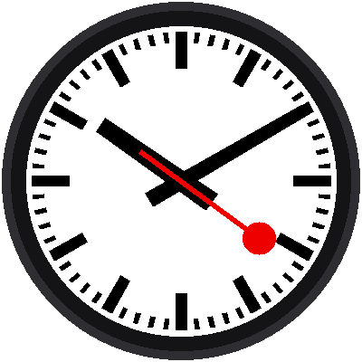

# Lab 10: A Smooth Sweep

{ width="360" }

An ordinary clock's second hand jumps. A Swiss station clock's second
hand *glides*. This lab makes the red hand sweep around the dial in
many tiny steps a second, one lap a minute. It also teaches the program to
measure itself.

!!! mascot-welcome "Welcome to Lab 10"
    { class="mascot-admonition-img" }
    The Pico's clock only counts whole seconds, so how do you draw
    something that moves *between* the ticks? That's the puzzle in this
    lab. Let's make time tick!

## What You Will Learn

- what a **millisecond** is, and how to count them
- how an angle is a **fraction of a lap** times 360
- how a program can **measure its own speed**

## Run It

Open `10-smooth-sweep.py` in Thonny and click **Run**. Wait about a second
for the red hand to start. Then it glides around the dial, and every five
seconds Thonny's shell reports how fast the display is:

```
20.2 frames a second
```

A **frame** is one picture. Twenty frames a second looks smooth. Your
board may report a different number, and that's useful to know.

## Counting Milliseconds

A millisecond is a thousandth of a second. The Pico has a counter,
`time.ticks_ms()`, that goes up by one every millisecond. To count time
*between* the real-time clock's ticks, the program does this:

1. wait for the instant the clock's seconds change
2. write down `ticks_ms()` at that instant
3. from then on, **milliseconds since then** = `ticks_ms()` now minus the
   number it wrote down

```python
first = time.localtime()[5]
while time.localtime()[5] == first:
    time.sleep_ms(1)
start_tick = time.ticks_ms()
start_second = time.localtime()[5]
```

And in the loop, `time.ticks_diff()` does the subtraction. It keeps
working even when the counter reaches its biggest number and starts over.

## A Fraction of a Lap

Say 15,000 milliseconds of this minute have gone by. That is 15,000 ÷
60,000 = a quarter of the minute, so the hand has made a quarter of a lap,
a quarter of 360° = 90°:

```python
second_angle = ms_into_minute / 60000 * 360
```

!!! mascot-thinking "The Angle Comes From the Clock, Not the Count"
    { class="mascot-admonition-img" }
    The program never counts frames, and it never adds a little to the
    angle each time. It asks the clock where the hand *should* be right now.
    That means a slow frame can never make the hand run behind.

## Pacing the Loop

Each pass through the loop draws one frame, then waits for whatever is
left of `FRAME_MS`:

```python
spent = time.ticks_diff(time.ticks_ms(), frame_start)
time.sleep_ms(max(1, FRAME_MS - spent))
```

If drawing took 30 ms and `FRAME_MS` is 50, it sleeps 20 ms. If drawing
took longer than 50, it sleeps just 1 ms (`max` picks the bigger number)
and moves on. A slower display just gives you fewer frames, and the hand
is still in the right place.

!!! tip "Try This"
    1. Change `FRAME_MS = 50` to `FRAME_MS = 200`. How does the sweep
       look at 5 frames a second?
    2. Change `/ 60000 * 360` to `/ 6000 * 360`. How long is one lap now?
    3. Does the red hand ever stutter when it points straight up or
       straight down? Check the frames-a-second number as it passes.

!!! mascot-celebration "A Gliding Hand!"
    { class="mascot-admonition-img" }
    You counted milliseconds, turned a fraction of a minute into an angle,
    and paced a loop by measuring it. Next, you'll teach the red hand to
    stop and wait.

**Next:** [Lab 11: Stop at Twelve](11-stop-at-twelve.md)
