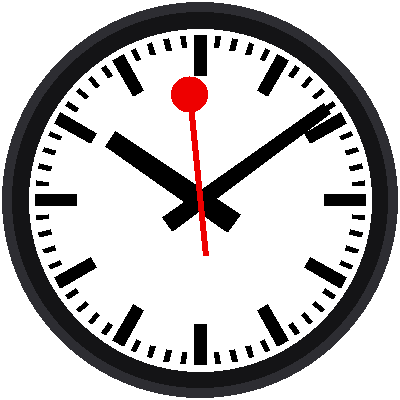

# Lab 11: Stop at Twelve

{ width="360" }

Here is the first half of the trick that makes this clock famous. The red
hand glides once around the dial in **58.5 seconds**, then **stops at the
top and waits** for a second and a half before it sets off again.

!!! mascot-welcome "Welcome to Lab 11"
    { class="mascot-admonition-img" }
    A hand that waits is more interesting than a hand that never stops. In
    this lab, your clock learns to pause, and the pause is where all the
    magic will happen in the next lab. Let's make time tick!

## What You Will Learn

- how to split a repeating cycle into **phases**
- how **if / else** picks the phase
- how to give a number a **name** that says what it means

## Run It

Open `11-stop-at-twelve.py` in Thonny and click **Run**. After about a
second, watch the red hand. When it reaches 12 it stops, and a moment
later it starts again.

## Why Does It Wait?

On the real station clocks, the second hand is driven by its own little
motor, and it runs a hair fast. It circles the dial in about 58.5 seconds
and then parks at 12 until the next minute pulse arrives from a master
clock. Thousands of clocks stay in step without any of them having to be
perfect, and people love the pause.

## Two Phases

Each minute has two parts:

| Part of the minute | Milliseconds | What the red hand does |
|---|---|---|
| **Sweep** | 0 to 58,500 | glides from 0° to 360° |
| **Hold** | 58,500 to 60,000 | rests at the top |

The program checks which part it is in:

```python
SWEEP_MS = 58500

if ms < SWEEP_MS:
    second_angle = ms / SWEEP_MS * 360      # gliding
else:
    second_angle = 0                        # waiting at the top
```

`ms` is how many milliseconds of the current minute have passed. The 58.5
seconds is written once, as `SWEEP_MS`, instead of being buried inside a
formula. A name like that tells a reader what the number is for.

## Where Does `ms` Come From?

Lab 10 waited for the clock's seconds to change, wrote down
`ticks_ms()`, and counted from there. This lab uses that same idea, packed
into a ready-made part:

```python
clock = mondaine.SweepClock()
...
hour, minute, ms = clock.now()
```

`clock.now()` hands back the hour, the minute, and the milliseconds into
the minute. All of the counting from lab 10 is inside it.

!!! mascot-thinking "A Cycle Is Just a Number Line"
    { class="mascot-admonition-img" }
    Everything this clock does happens at some spot between 0 and 60,000
    milliseconds. When you can draw the minute as a line with labeled
    stretches, writing the program is just asking "which stretch am I in?"

!!! tip "Try This"
    1. Change `SWEEP_MS` to `50000`. The pause gets long, and the hand
       moves faster. Why does the speed change?
    2. Set `SWEEP_MS = 60000`. The pause disappears. What does the hand do
       when it reaches the top?
    3. Add `print(ms)` inside the loop and watch the shell. At what number
       does it start over?

!!! mascot-celebration "The Hand Waits!"
    { class="mascot-admonition-img" }
    You split a minute into a sweep and a hold, and used `if / else` to
    choose between them. Next, you'll put the pause to work.

**Next:** [Lab 12: The Minute Jump](12-minute-jump.md)
