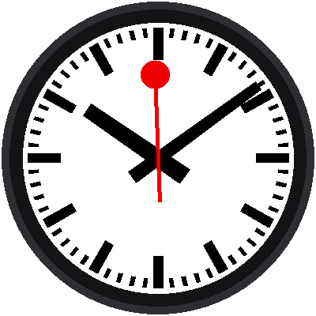

# Lab 12: The Minute Jump

{ width="360" }

This is the best part of the whole kit. When the red hand stops at 12, the
**minute hand hops ahead one minute while it waits**, and the hour hand
creeps along with it. Then the red hand sets off again. Watch the picture
above a few times: the pause is not an accident. It's a stage, and the
minute hand is the actor.

!!! mascot-welcome "Welcome to Lab 12"
    { class="mascot-admonition-img" }
    Everything you built so far was leading to this lab. You'll teach the
    minute hand to move with a smooth start and a soft landing, in the
    exact moments the red hand is standing still. Let's make time tick!

## What You Will Learn

- how to write a **function that returns a number**
- what an **easing curve** is, and why it looks better than a straight line
- how to **clamp** a number so it stays in a range

## Run It

Open `12-minute-jump.py` in Thonny and click **Run**. You'll have to be
patient: the hop happens once a minute. Watch the clock near the end of
a minute. The red hand arrives at 12 and stops. A beat later, the
minute hand begins to hop.

## The Timeline of One Minute

| From (ms) | To (ms) | What happens |
|---|---|---|
| 0 | 58,500 | The red hand glides around the dial |
| 58,500 | 58,650 | Everything is still. A tiny beat. |
| 58,650 | 59,370 | **The minute hand hops.** |
| 59,370 | 60,000 | Everything is still again. |
| 60,000 | | The red hand sets off. A new minute begins. |


## Easing: A Hop with Weight

Suppose the hop took 720 ms. The simplest way to move the minute hand is
in a straight line: after half the time, it's half way. But a straight
line starts and stops at full speed, like a machine. A real hand with weight
speeds up gently and slows down gently. A curve that does that is called
an **easing curve**, and the one this lab uses is called `smootherstep`:

```python
def smootherstep(x):
    x = max(0.0, min(1.0, x))
    return x * x * x * (x * (x * 6 - 15) + 10)
```

You give it a number from 0.0 (the start) to 1.0 (the end), and it gives
back how far along the hop should be:

| Time through the hop | 0.0 | 0.25 | 0.5 | 0.75 | 1.0 |
|---|---|---|---|---|---|
| Straight line | 0.0 | 0.25 | 0.5 | 0.75 | 1.0 |
| `smootherstep` | 0.0 | 0.10 | 0.5 | 0.90 | 1.0 |

Early on, the curve moves *less* than the line. In the middle it catches
up, and at the end it slows down again.

!!! mascot-thinking "A Function Can Be a Shape"
    { class="mascot-admonition-img" }
    You can think of `smootherstep` as a shape drawn on graph paper: an S.
    You hand it any number from 0 to 1 and it gives you the height of the S
    at that spot. Any move on a screen can borrow that shape.

The line `x = max(0.0, min(1.0, x))` is **clamping**. `min(1.0, x)` stops x
from going above 1, and `max(0.0, ...)` stops it from going below 0. So
before the hop starts, the answer is 0.0, and after it ends, the answer is
1.0, with no extra `if` needed.

## The Hop

A second function turns the time into "how far through the hop":

```python
def hop(ms):
    return smootherstep((ms - HOP_START_MS) / HOP_MS)
```

And then the three angles use it. The minute hand moves one minute (6°)
times `step`, and the hour hand moves its half degree:

```python
step = hop(ms)                                # 0.0 ... 1.0
minute_angle = (minute + step) * 6
hour_angle = (hour % 12) * 30 + (minute + step) * 0.5
second_angle = min(ms, SWEEP_MS) / SWEEP_MS * 360
```

Notice what *doesn't* appear: no `if` for "is the red hand stopped?" The
numbers do it by themselves. The hop starts at 58,650 ms, which is after
the 58,500 ms when the red hand stops, so the minute hand only moves
while the red hand stands still.

## Staying in Step with the Real Time

The program also checks itself against the Pico's real-time clock once
a minute, while everything is at rest:

```python
if ms >= RESYNC_MS and not synced:
    clock.sync()
    synced = True
```

`clock.sync()` waits for the next tick of the clock, then starts counting
again from it. The red hand therefore sets off exactly at the top of the
minute, and the clock can never drift away from the real time.

!!! mascot-tip "Don't Wait a Whole Minute"
    { class="mascot-admonition-img" }
    Click **Run** when the seconds on your computer's clock are around 50.
    The red hand starts partway around the dial, and the first hop arrives
    in about ten seconds.

!!! tip "Try This"
    1. Replace `smootherstep((ms - HOP_START_MS) / HOP_MS)` with just
       `max(0.0, min(1.0, (ms - HOP_START_MS) / HOP_MS))`. That's a straight
       line. Can you see the difference?
    2. Change `HOP_START_MS` to `58500`. What does it feel like when the
       hop begins the instant the red hand stops?
    3. Change `HOP_MS` to `1200`. It still fits inside the pause. Now try
       `2000`. The hop runs past the end of the pause, so why does that
       look wrong?

!!! mascot-celebration "The Signature Move!"
    { class="mascot-admonition-img" }
    You wrote an easing function, clamped it with `min` and `max`, and
    timed a minute-hand hop to land inside the red hand's pause. Next, you'll
    test the three buttons.

**Next:** [Lab 13: Button Test](13-button-test.md)
