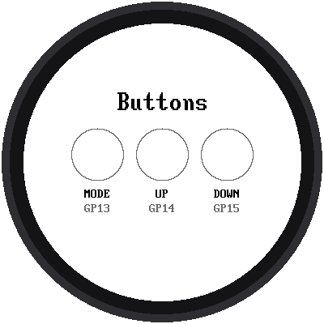

# Lab 13: Test the Buttons

{ width="360" }

Your clock has three buttons: **MODE**, **UP**, and **DOWN**. Before you
write programs that use them, this lab checks that each one is wired
correctly. Each circle on the screen fills with color while you hold its
button down.

!!! mascot-welcome "Welcome to Lab 13"
    { class="mascot-admonition-img" }
    Up to now, your clock has only talked. With buttons, it can listen!
    The next two labs use them, so a quick test now saves a lot of
    head-scratching later. Let's make time tick!

## What You Will Learn

- how the Pico reads a button
- what a **pull-up** is, and why a pressed button reads 0
- how to loop over a **list of tuples**

## Run It

Open `13-button-test.py` in Thonny and click **Run**. Press each button
one at a time:

| Button | Pico pin | Circle fills with |
|---|---|---|
| MODE | GP13 | blue |
| UP | GP14 | green |
| DOWN | GP15 | red |

Thonny's shell also prints a line each time, like `UP pressed` and
`UP released`.

## How a Button Talks to the Pico

A button is just a switch. When you press it, it connects its pin to
**GND** (ground). But what does the pin read when the button is *not*
pressed? Without help, nothing is connected, and the pin would read
random 0s and 1s, like a radio tuned between stations.

So the program turns on the Pico's **pull-up**: a tiny built-in
connection that gently pulls the pin up to 1. Pressing the button
connects the pin straight to ground, which wins, so the pin reads 0.

| Button is... | Pin reads |
|---|---|
| not pressed | **1** |
| pressed | **0** |

It seems backwards, but it's how almost every button on every gadget
works. That's why the program checks for 0:

```python
held = pin.value() == 0
```

## One List Holds Everything About a Button

Each button has a pin, a name, a pin label, a spot on the screen, and a
color. Rather than make five separate variables for each of three
buttons, the program keeps a **list of tuples**:

```python
BUTTONS = (
    (mode, "MODE", "GP13", 100, config.BLUE),
    (increment, "UP", "GP14", 180, config.GREEN),
    (decrement, "DOWN", "GP15", 260, config.RAIL_RED),
)
```

Then one loop draws all three circles, and the same loop checks all three
buttons. Adding a fourth button would mean adding one line to the list.

## Only Draw When Something Changes

The program checks the buttons 50 times a second. It remembers what each
button looked like last time, in a list called `last`, and only redraws a
circle when its button changes. It's the same idea as `last_second` in
[lab 09](09-tick-tock.md).

!!! tip "Try This"
    1. Press two buttons at once. Does the program handle it?
    2. Change the colors in the list called `BUTTONS`.
    3. Add a counter that prints how many times UP has been pressed.

## If It Doesn't Work

- **A circle never fills.** That button isn't connected. An unconnected
  button reads 1, "not pressed," forever. Check that one leg goes to the
  right pin and the other leg goes to GND.
- **A circle is filled even when you're not touching anything.** That
  pin is connected straight to ground. Check for a wire in the wrong row
  of the breadboard.

!!! mascot-celebration "Buttons Tested!"
    { class="mascot-admonition-img" }
    You now know why a pressed button reads 0, and how to keep a button's
    details in one list. Next, you'll use these buttons to set the time by
    hand.

**Next:** [Lab 14: Set the Time with the Buttons](14-set-time.md)
