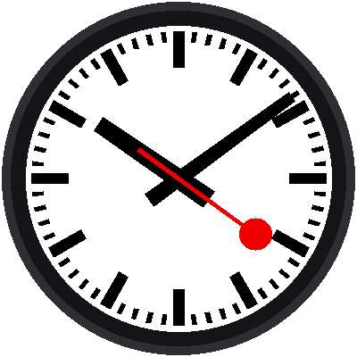

# Lab 14: Set the Time with the Buttons

{ width="360" }

What if there's no WiFi? A real clock lets you set the time by hand. This
lab does too:

| Button | What it does |
|---|---|
| **MODE** | Steps through: run → set hour → set minute → run |
| **UP** | Moves the hand being set forward one step |
| **DOWN** | Moves it back one step |

While you set the time, a yellow label (SET HOUR or SET MINUTE) appears
below the center, and the red hand waits at 12. Hold UP or DOWN and the
hand keeps moving by itself, so you don't have to press 45 times to get
to 45 minutes.

!!! mascot-welcome "Welcome to Lab 14"
    { class="mascot-admonition-img" }
    After this lab, your clock can be set anywhere, even with no WiFi, just
    like a store-bought clock. You'll also fix a sneaky problem hiding
    inside every button. Let's make time tick!

## What You Will Learn

- why a single press can count as three (and how to fix it)
- how "hold to repeat" works
- what a **class** is
- how to set the Pico's clock from a program

## Run It

Open `14-set-time.py` in Thonny and click **Run**. Then:

1. Press **MODE**. The label says SET HOUR.
2. Press **UP** or **DOWN**. The hour hand moves.
3. Press **MODE** again. Now the label says SET MINUTE.
4. Change the minutes, then press **MODE** once more to get back to the
   running clock.

Each time UP or DOWN changes the minutes, the seconds go back to zero.
That way you can match another clock exactly. Set the minutes to what
that clock shows now, one press short of its next minute. Then press UP
one last time right when that clock gets there.

## Problem 1: Bouncing Buttons

Inside a button, two bits of metal touch when you press it. But they
don't touch just once. They bounce, like a basketball, touching and
letting go several times in a few thousandths of a second. The Pico is so
fast that it sees every bounce as a separate press, so one push could move
the hour three places!

The fix is called **debouncing**: after the button changes, ignore it for
the next 40 thousandths of a second (40 **milliseconds**, or ms). By then,
the bouncing has stopped.

```python
DEBOUNCE_MS = 40
```

## Problem 2: Hold to Repeat

Pressing a button 45 times would be miserable. So if a button is held for
half a second, it starts "pressing itself" about 8 times a second until
you let go:

```python
HOLD_MS = 500      # wait this long before repeating
REPEAT_MS = 120    # then repeat this often
```

## A Class Keeps Each Button's Memory

Both fixes need each button to remember things: when it last changed,
whether it is held, and when to repeat next. That calls for a **class**,
a blueprint for a kind of object. The program makes one `Button` from the
blueprint for each real button, and each keeps its own notes:

```python
mode_button, up_button, down_button = [
    Button(pin) for pin in config.init_buttons()]
```

Later, `up_button.pressed(now, repeat=True)` asks that one button: "were
you just pressed?"

!!! mascot-thinking "Objects Remember"
    { class="mascot-admonition-img" }
    A plain function forgets everything when it finishes. An object made
    from a class keeps its own variables between calls, so three buttons can
    each remember their own story at the same time.

## Setting the Pico's Clock

Once you change a number, the program writes the new time into the
Pico's real-time clock:

```python
rtc.datetime((year, month, day, weekday, hour, minute, second, 0))
```

The red hand waits at 12 during all this: the program draws it at second
0 whenever a set mode is active. The label is drawn *after* the hands, so
it always lies on top.

!!! tip "Try This"
    1. Change `DEBOUNCE_MS` to `0`. Can you get one press to count twice?
    2. Change `REPEAT_MS` to `40`. Now how fast does the hand move?
    3. Make the label red on white by changing the two colors in the
       `centered_text` call.

!!! mascot-celebration "Set It Yourself!"
    { class="mascot-admonition-img" }
    You tamed bouncing buttons, made them repeat when held, and wrote a new
    time into the Pico's clock. Next, you'll put every lab together into one
    finished railway clock.

**Next:** [Lab 15: The Railway Clock](15-mondaine-clock.md)
