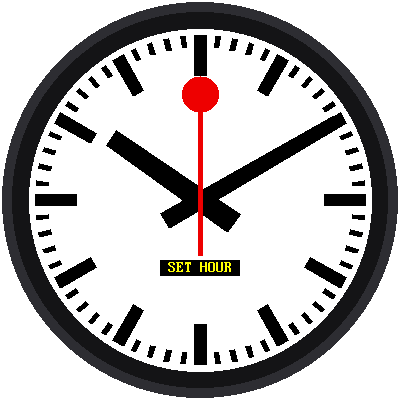

# Lab 15: The Railway Clock

{ width="360" }

Everything you built, in one program. Your clock sets itself from the
internet, glides the red hand around the dial, parks it at 12 while the
minute hand hops, and sets itself again every night while you sleep. You
can set it by hand, too.

!!! mascot-welcome "Welcome to Lab 15"
    { class="mascot-admonition-img" }
    This is the clock you've been building toward. Nothing in this lab is
    new, because every piece is something you already tested on its own.
    Let's make time tick!

## What You Will Learn

- how to **assemble a program** from parts you tested one at a time
- how a program uses its quiet moments for **housekeeping**
- how to make the Pico start your program by itself

## Run It

Open `15-mondaine-clock.py` in Thonny and click **Run**. The screen says
"Setting clock" while the Pico asks the internet for the time (this needs
`secrets.py`, as in [lab 08](08-wifi-sync-time.md)). Then the dial appears,
and the red hand starts to glide.

| Button | What it does |
|---|---|
| **MODE** (short press) | Steps through: run → set hour → set minute → run |
| **MODE** (hold for a second) | Sets the clock from the internet right now |
| **UP** | In a set mode: one step forward. Hold it to repeat. |
| **DOWN** | In a set mode: one step back. Hold it to repeat. |

{ width="240" }

No WiFi? Change `SYNC_WITH_WIFI = True` to `False` near the top of the
program. The clock then runs on whatever time the Pico has. Use the set
modes to fix it.

## Who Does What

The program itself is short, because the work is done by parts you
already know:

| Part | Where it came from |
|---|---|
| `mondaine.Face` draws the dial and moves the hands | Labs 02 to 07 |
| `mondaine.SweepClock` counts milliseconds | Lab 10 |
| `mondaine.hand_angles()` does the sweep, the pause, and the hop | Labs 11 and 12 |
| `wifi_time` sets the clock from the internet | Lab 08 |
| `buttons.Button` reads the buttons | Labs 13 and 14 |

The main loop in this file only decides *when* each part should act. In
run mode, one frame is just two lines:

```python
hour, minute, ms = clock.now()
face.show(*mondaine.hand_angles(hour, minute, ms))
```

!!! mascot-thinking "Small Parts, Big Program"
    { class="mascot-admonition-img" }
    The whole clock fits on one screen of code because each lab left a
    working piece behind. When you add your own feature, the same rule helps:
    build it as a small part, test it alone, and then plug it in.

## Housekeeping While the Hand Waits

Once a minute, for about a second, nothing on the face moves: the minute
hand has landed, and the red hand is still waiting at 12. The program uses
that moment for chores, when nobody can see a hiccup:

1. `clock.sync()` lines the millisecond counter up with the real-time clock
   again, so the red hand always sets off exactly at the top of the minute.
2. At **3:00 AM**, once a day, it asks the internet for the right time.

```python
if ms >= mondaine.RESYNC_MS:
    if not at_rest:
        at_rest = True
        ...                    # the nightly WiFi check
        clock.sync()
else:
    at_rest = False
```

The variable `at_rest` makes sure the chores run once per pause instead of
on every pass through the loop.

!!! mascot-warning "The Clock Stands Still While It Talks to WiFi"
    { class="mascot-admonition-img" }
    Connecting to WiFi can take several seconds, and nothing moves in that
    time. That's why the nightly sync happens at 3 AM, and why a held MODE
    button shows "Setting clock" on the screen. When it finishes, the clock
    catches up to the right time at once.

## Make It Start by Itself

When the Pico is powered on, it automatically runs a file named `main.py`
if there is one. Save a copy of this lab to the Pico as `main.py`, and
the clock starts on its own, even with no computer attached.

## Your Own Features

Here are things to try once it runs:

1. **A calmer hop.** Change `ADVANCE_MS` in `lib/mondaine.py` and compare.
   Is a slower hop better? (Keep `ADVANCE_START_MS + ADVANCE_MS` under
   60,000, or the hop runs past the pause.)
2. **A different red.** Change `RAIL_RED` in `config.py`.
3. **A smaller face.** The dial's size is one number, `UNIT = 3.4`, in
   `lib/mondaine.py`. Make it 3.2 for a wider white margin.
4. **A different pause.** Change `SWEEP_MS`. The pause is whatever is left
   of the minute, so a smaller `SWEEP_MS` makes a longer wait. Move
   `ADVANCE_START_MS` so the hop still starts after the red hand stops.

!!! mascot-celebration "You Built a Railway Clock!"
    { class="mascot-admonition-img" }
    You drew the face from design units, timed a hand that waits while
    another one hops, and put it all in one program that sets itself. That's
    a lot of Python in one kit. What will you build next?

**Back to:** [The Railway Clock Kit](index.md)
