# Railway Clock Kit (Mondaine-Style)

**Build the clock from the Swiss railway station: a plain white face, bold
black hands, and a red second hand that stops at the top of every minute
while the minute hand hops.**

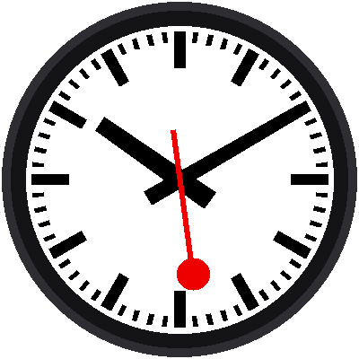{ width="360" }

Look closely at a Swiss station clock and you'll notice something odd. The
red second hand glides around the dial, then **stops at the top** and
waits for a moment. While it waits, the minute hand **hops forward one
minute**. Then the red hand sets off again. It happens once every minute,
and once you've seen it, you'll watch for it every time.

Your clock does the same thing, on a bright round screen, and **you write
every line of its code.** Along the way you learn real Python, the same
language used by scientists and game makers.

**Ages 10 and up. No soldering. No experience needed. Under $20 in parts.**

!!! mascot-welcome "Meet Chrono"
    { class="mascot-admonition-img" }
    Hi, I'm Chrono! I'm a robot, and my head is the same kind of round
    screen you're about to program. I'll pop up in the labs to give you
    tips, warn you about traps, and cheer when you finish. Let's make time
    tick!

## What Your Clock Will Do

- **Look like a station clock.** A white dial, twelve heavy bars, 48 small
  ones, tapered black hands, and a red hand with a round disc on its end.
- **Glide, stop, and hop.** The red hand takes 58.5 seconds to circle the
  dial and then waits 1.5 seconds at 12. The minute hand moves during the
  wait, with a smooth start and a soft landing.
- **Set its own time.** It asks the internet what time it is, so it is
  never wrong.
- **Be set by hand.** Three buttons set the hour and the minute when there
  is no WiFi.

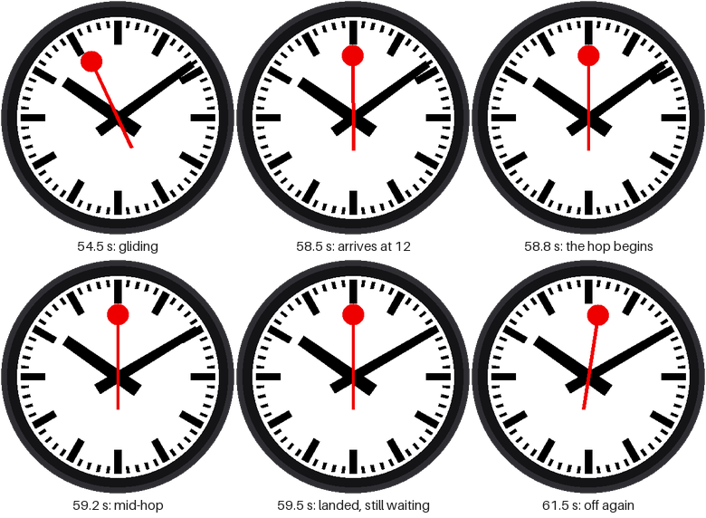

## How It Works

There are 16 short labs, numbered 00 to 15. Each lab is one program, and
each one teaches a single new idea that you use in the labs after it.

1. **Wake it up (labs 00-01).** Blink a light and say hello on the screen.
2. **Build the face (labs 02-06).** Place dots, then bars, then hands, one
   idea at a time, until the finished face appears on the screen.
3. **Make it tell time (labs 07-09).** Read the Pico's clock, set it from
   the internet, and make the red hand tick.
4. **Make it glide, stop, and hop (labs 10-12).** The three labs that
   make this clock special.
5. **Make it yours (labs 13-15).** Test the buttons, set the time by hand,
   and put everything together.

## Why Kids (and Grown-Ups) Like It

- **You see results fast.** Every lab ends with something new on the
  screen, not just text in a window.
- **A real design.** The proportions come from one of the most famous clock
  faces in the world, so you also learn why it looks the way it does.
- **It is a real computer.** The Raspberry Pi Pico W is the same kind of
  chip found in appliances, toys, and instruments.
- **Mistakes are cheap and safe.** Nothing you type can break the kit. The
  only thing to watch is one wire, and the kit tells you which.

## For Parents

- **What your child learns:** Python programming (variables, loops,
  functions, classes), the math of angles, how a computer reads buttons and
  draws to a screen, and how a clock keeps time.
- **How much help they need:** Most 10-12 year olds do the labs on their
  own once the kit is set up. An adult helps most with the first-time setup
  (about 30 minutes).
- **Privacy and safety:** The clock has **no microphone and no camera**. It
  connects to your home WiFi only to get the time, and it stores nothing
  about your family. It runs on a 5-volt USB cable, so there is no mains
  wiring.
- **What it costs:** Under $20 in parts (a $5 Pico and a $6 display are the
  big two), and no subscription. The parts are the same ones as the
  [Chrono Smart Clock Kit](../sw-gc9b72/index.md), so a kit you already
  have runs both. See [Notes for Teachers](teacher-notes.md#sourcing-parts)
  for where to buy.

## For Teachers, Mentors, and Volunteers

- **Fits a class period.** Each lab is a self-contained 30-45 minute
  session with a working result at the end. Labs 00-04 make a good first
  meeting.
- **One new idea per lab.** The concept list is in the
  [Notes for Teachers](teacher-notes.md#the-lab-sequence): loops, math,
  functions, `%` and `if`, tuples, `while`, `if / else` phases, easing,
  and classes.
- **No soldering, no special tools.** Everything plugs into a breadboard.
- **Runs on what you have.** Any computer that runs Thonny (Windows, Mac,
  Chromebook, Linux) works.
- **Every picture is real.** The screen images come from the labs' own code
  running on a simulator of the display, so what students see in the book
  is what the code draws.

## What's in the Kit

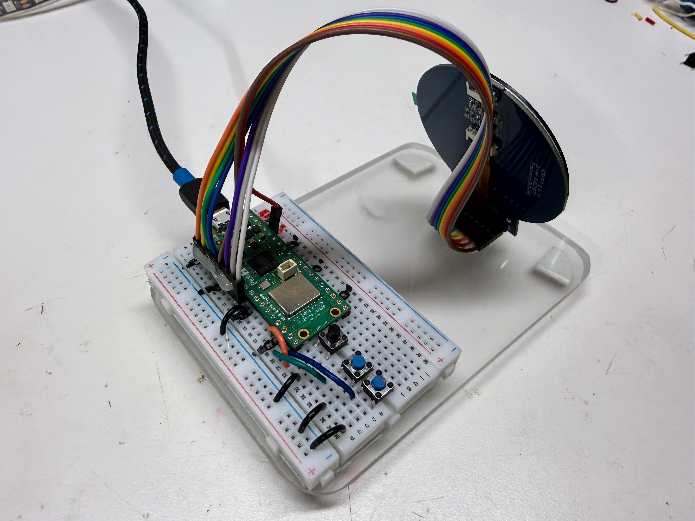 
*A rear view of the kit showing the breadboard, buttons and a 20cm Dupont
cable with hot glue to make it easy for the student to connect the
display.*

| Part | What it does |
|---|---|
| **Raspberry Pi Pico W** | The brain of the clock. It's a *microcontroller*, a tiny computer on a board about the size of a stick of gum. The **W** means it has WiFi, so it can talk to the internet. A Pico 2 W works too. |
| **Round color display** | The clock face. It is 2.1 inches across and has 360 × 360 tiny dots of light called **pixels**. A chip on the back called the **GC9B72** turns the Pico's messages into pictures. |
| **Three push buttons** | How you control the clock. They are called **MODE**, **UP**, and **DOWN**. |
| **Breadboard and wires** | Connect everything without soldering. |
| **USB cable** | Gives the Pico power, and lets your computer send it programs. |

## How It Is Wired

The display has a row of 10 connection points along its bottom edge.
Reading from left to right, they are labeled:
**GND VCC SCL SDA RST DC CS BL SDO TE**.
Only the first eight are used. Each one connects to a numbered pin on the
Pico, like this:

| Display pin | Pico pin | Wire color | What it carries |
|---|---|---|---|
| GND | GND | black | Ground, the "minus" side of the power |
| VCC | 3V3 | red | Power, 3.3 volts |
| SCL | GP2 | orange | The clock beat that keeps the Pico and display in step |
| SDA | GP3 | yellow | The data: the actual colors of the pixels |
| RST | GP4 | green | Reset: tells the display to start fresh |
| DC | GP5 | blue | Says whether the next data is a command or a picture |
| CS | GP6 | purple | "Hey display, I'm talking to you!" |
| BL | GP7 | gray | The backlight that makes the screen glow |

!!! mascot-warning "Use 3V3, Not 5 Volts"
    { class="mascot-admonition-img" }
    The display's VCC wire must go to the Pico's **3V3** pin. The display
    is built for 3.3 volts, and 5 volts can damage it. Just a few pins
    away are **VSYS** and **VBUS**, which carry about 5 volts from the USB
    cable, so double-check the label before you plug in.

The last two pins on the row, **SDO** and **TE**, stay unconnected. The
clock only ever sends pictures *to* the display, so it never needs them.

Each button has two legs. One leg goes to a Pico pin, and the other goes
to GND:

| Button | Pico pin | What it does in this kit |
|---|---|---|
| MODE | GP13 | Steps through run, set hour, set minute. Hold it to set the clock from the internet. |
| UP | GP14 | Moves the hand being set forward |
| DOWN | GP15 | Moves the hand being set back |

## Before You Start

You only need to do these steps once.

1. **Put MicroPython on the Pico.** MicroPython is the version of the
   Python language that runs on small boards like the Pico. Be sure to use
   the version that matches your board, for the
   [Pico W](https://micropython.org/download/RPI_PICO_W/) or the
   [Pico 2 W](https://micropython.org/download/RPI_PICO2_W/). The versions
   for the plain Pico and Pico 2 have no WiFi.
2. **Install Thonny.** [Thonny](https://thonny.org) is the program you
   will use to write code and send it to the Pico.
3. **Copy the kit's files onto the Pico.** The labs need some helper files
   that live in a folder called `lib` on the Pico, and a settings file
   called `config.py`. Your teacher may have done this for you. If not, the
   kit folder has a script called `upload-code.sh` that copies everything
   at once.
4. **Tell the clock about your WiFi.** Copy the file `secrets-template.py`
   to a new file called `secrets.py`, and type in your WiFi network's name
   and password. Labs 08 and 15 use it. (`secrets.py` is kept private: it
   never gets shared online.)
5. **Tell the clock your time zone.** Open `config.py` and find
   `TIMEZONE_HOURS`. Use -5 for Eastern time, -6 for Central, -7 for
   Mountain, or -8 for Pacific.

## The Labs

Click a picture to open that lab.

| Lab | | What you will do |
|---|---|---|
| [00](00-blink-onboard-led.md) | [{ width="110" }](00-blink-onboard-led.md) | Make a tiny light on the Pico blink, to check that everything works |
| [01](01-hello-display.md) | [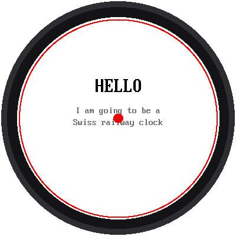{ width="110" }](01-hello-display.md) | Say hello on the round screen |
| [02](02-dial-dots.md) | [{ width="110" }](02-dial-dots.md) | Place twelve dots in a circle with sine and cosine |
| [03](03-hour-markers.md) | [{ width="110" }](03-hour-markers.md) | Draw the twelve heavy hour bars with your own functions |
| [04](04-minute-markers.md) | [{ width="110" }](04-minute-markers.md) | Add the 48 small minute bars with `%` and `if` |
| [05](05-black-hands.md) | [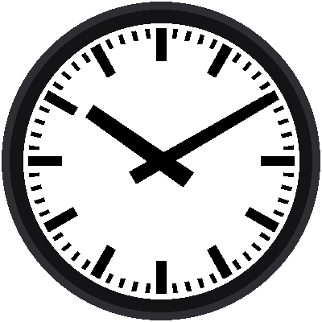{ width="110" }](05-black-hands.md) | Turn a time into angles and draw the black hands |
| [06](06-red-second-hand.md) | [{ width="110" }](06-red-second-hand.md) | Add the red second hand, and finish the face |
| [07](07-read-the-time.md) | [{ width="110" }](07-read-the-time.md) | Show the Pico's real time on the face |
| [08](08-wifi-sync-time.md) | [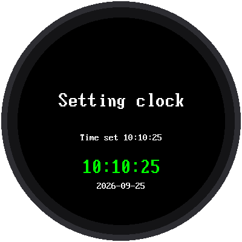{ width="110" }](08-wifi-sync-time.md) | Ask the internet what time it is |
| [09](09-tick-tock.md) | [{ width="110" }](09-tick-tock.md) | Make the red hand tick once a second |
| [10](10-smooth-sweep.md) | [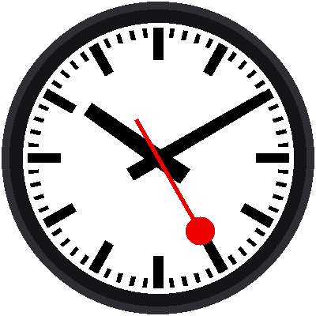{ width="110" }](10-smooth-sweep.md) | Make the red hand glide, in milliseconds |
| [11](11-stop-at-twelve.md) | [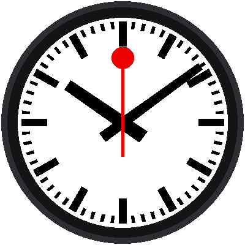{ width="110" }](11-stop-at-twelve.md) | Make the red hand stop at 12 and wait |
| [12](12-minute-jump.md) | [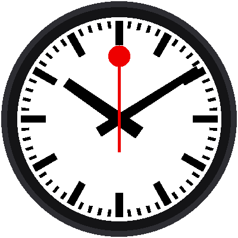{ width="110" }](12-minute-jump.md) | Hop the minute hand during the wait |
| [13](13-button-test.md) | [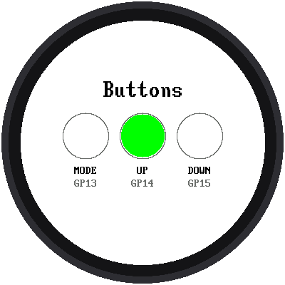{ width="110" }](13-button-test.md) | Test the three buttons |
| [14](14-set-time.md) | [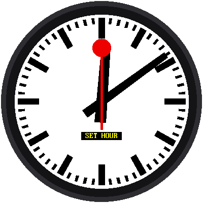{ width="110" }](14-set-time.md) | Set the time with the buttons |
| [15](15-mondaine-clock.md) | [{ width="110" }](15-mondaine-clock.md) | Put it all together into one finished clock |

!!! mascot-tip "Which Program Is Running?"
    { class="mascot-admonition-img" }
    Every lab prints its name and version number in Thonny's shell when it
    starts, like `12-minute-jump.py v1.0`. If the screen isn't doing what
    you expect, check that line first. It tells you which program the Pico
    is actually running.

## Words to Know

| Word | What it means |
|---|---|
| **Pixel** | One tiny dot of light on the screen. This screen has 360 × 360 = 129,600 of them. |
| **Microcontroller** | A small computer built to control one thing, like a clock, a toy, or a microwave. |
| **Program** | A list of instructions for a computer, written in a language like Python. |
| **Loop** | Part of a program that repeats over and over. A clock's program runs in a loop forever. |
| **Variable** | A name that holds a value, like `second = 42`. |
| **Function** | A named set of instructions you can use again and again, like `bar()`. |
| **Module** | A file of Python code that other programs can borrow from with `import`. |
| **Millisecond** | A thousandth of a second. The red hand is redrawn every 50 or so of them. |
| **Easing** | Making a move start slowly and end gently, instead of starting and stopping all at once. |
| **WiFi** | A way for devices to connect to the internet without wires. |

## About the Design

The look of this clock follows the Swiss railway station clock, designed
for the Swiss Federal Railways (SBB) in the 1940s. This kit is an
independent project for learning. It is not made, sold, or endorsed by SBB
or by Mondaine, and the face has no logo or brand name on it. "SBB" and
"Mondaine" belong to their owners.

## For Teachers

The [Notes for Teachers](teacher-notes.md) page has the technical details:
the lab sequence and the idea each lab introduces, how the face is drawn
without flicker, the timing of the stop-and-go, what has and hasn't been
tested on real hardware, and a troubleshooting table. The screen pictures
in these pages were made by running each lab's real code in a simulator of
the display.
