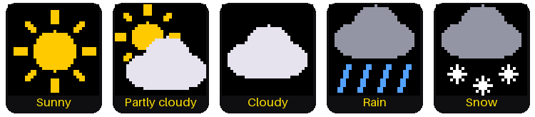

# Lab 14: Weather Clock

{ width="336" }

Now your clock knows more than the time. Every half hour it asks the
internet for the forecast. Then it shows today's and tomorrow's highs and
lows, each with a small weather picture.

The picture shows a made-up forecast: partly cloudy, 70 and 58, then
rain, 61 and 57. Yours will be the real one for your town.

!!! mascot-welcome "Welcome to Lab 14"
    { class="mascot-admonition-img" }
    Will you need a jacket tomorrow? After this lab your clock can tell
    you, with the same trick phone apps use to get scores and maps. Let's
    make time tick!

## What You Will Learn

- how a program gets facts from a computer on the internet
- how two numbers tell the forecast where you live
- how a weather code becomes a picture and a word
- how to draw a picture off-screen, so it never flickers

## Before You Start

1. Check that `secrets.py` is on the Pico.
   [Lab 10](10-wifi-sync-time.md) shows how to make it.
2. Open `config.py` and find the three lines below.
3. Search the web for "*your town* latitude longitude".
4. Type in your town's two numbers. Save `config.py` on the Pico, the
   way you did in lab 10.

```python
LATITUDE = 44.98
LONGITUDE = -93.27
TEMPERATURE_UNIT = "fahrenheit"      # or "celsius"
```

**Latitude** is how far north of the equator a place is, and
**longitude** is how far east or west. The kit comes set to Minneapolis,
in degrees Fahrenheit. In the United States the longitude is negative, so
keep the minus sign.

## Run It

1. Open `14-weather-clock.py` in Thonny and click **Run**.
2. Wait while the screen says `Weather clock`. The Pico joins your WiFi,
   gets the forecast, and sets the time.
3. Look at the face: the time and date on top, Today and Tomorrow below.
4. Find the line in Thonny's shell that starts with `Forecast:`.

```text
Forecast: [(70, 58, 2), (61, 57, 63)]
```

That line is the made-up forecast from the picture. Your numbers will be
different. Each pair of round brackets is one day: the high, the low, and
a **weather code**. A weather code is a number that stands for a kind of
weather.

## Asking for the Weather

A website sends back pages for people to read. A **web service** sends
back facts for programs to read. This kit asks a free weather service
called Open-Meteo, which needs no account.

The kit's file `forecast.py` sends your latitude and longitude. It asks
for the high, the low and the weather code, for today and tomorrow. This
part of it reads the answer:

```python
        days = []
        for i in range(2):
            days.append((round(daily["temperature_2m_max"][i]),
                         round(daily["temperature_2m_min"][i]),
                         daily["weather_code"][i]))
        print("Forecast:", days)
        return days
```

- `daily` holds the answer, and `daily["weather_code"]` picks out its
  list of codes.
- `for i in range(2)` runs twice: 0 is today and 1 is tomorrow.
- `round()` turns a temperature like 70.3 into the whole number 70.
- `print()` writes the `Forecast:` line you saw in the shell.

You may have asked a web service for a forecast before, in the
[weather lab of Learning MicroPython](https://dmccreary.github.io/learning-micropython/hands-on-labs/19-wireless-iot/08-get-weather/).

## From a Code to a Picture

The service doesn't say "rain". It sends a number, such as 63. The
function `forecast.describe()` turns each code into one of five icons,
plus a word or two for the screen.



```python
    if code <= 1:
        return SUNNY, "Sunny"            # 0 clear, 1 mainly clear
    if code == 2:
        return PARTLY_CLOUDY, "Pt cloudy"
    if code == 3:
        return CLOUDY, "Cloudy"
    if code in (45, 48):
        return CLOUDY, "Fog"
```

This is the top of `describe()`. It is a chain of `if` tests, and the
first one that is true decides the answer. Each `return` hands back two
things: an icon name and the words. Here are all the choices:

| Weather codes | Icon | Words on the screen |
|---|---|---|
| 0, 1 | Sunny | Sunny |
| 2 | Partly cloudy | Pt cloudy |
| 3, 45, 48 | Cloudy | Cloudy, Fog |
| 51 to 67, 80 to 82, 95 and up | Rain | Drizzle, Frz rain, Rain, Showers, T-storms |
| 71 to 77, 85, 86 | Snow | Snow |

In the picture, today's code is 2 and tomorrow's is 63. Find both in the
table.

## Draw It Off-Screen First

Each icon is built from circles, rectangles and lines. As you saw in
[lab 11](11-analog-clock-face.md), this screen shows every shape the
moment it is drawn. An icon built right on the screen would flicker.

So the program draws on scrap paper first: a small patch of memory called
a **frame buffer**. It holds one icon, 32 × 32 pixels. The icon is built
there, out of sight, then sent to the screen in one go.

```python
        if icon != shown_icons[column]:
            render_icon(icon)
            display.blit_buffer(icon_buffer,
                                COLUMN_X[column] + ICON_X_FROM_CENTER,
                                ICON_Y, ICON_SIZE, ICON_SIZE)
            shown_icons[column] = icon
```

- The `if` skips an icon that is already on the screen. The last line
  remembers the new one.
- `render_icon(icon)` draws the icon into `icon_buffer`, the scrap paper.
- `display.blit_buffer(...)` copies all 32 × 32 = 1,024 pixels to the
  screen at once.

One catch: the frame buffer stores each color's two halves, called bytes,
in the opposite order from the screen. So every icon color goes through
`swapped()` first, or the yellow sun comes out blue.

!!! mascot-thinking "Draw First, Show Later"
    { class="mascot-admonition-img" }
    Notice the pattern: build the picture where nobody can see it, then
    show it all at once. Video games do the same for every frame they
    draw.

!!! tip "Try This"
    1. In `config.py`, change `"fahrenheit"` to `"celsius"`. Save it and
       run the lab again.
    2. In `config.py`, try a faraway city. Miami is 25.76 and -80.19.
       Anchorage, Alaska is 61.22 and -149.90.
    3. In the lab, change `HIGH_COLOR` to `config.RED` and `LOW_COLOR` to
       `config.CYAN`.
    4. Find the comment line in `forecast.py` that starts with `curl`.
       Copy the web address between its quotation marks into a web
       browser to see what the Pico gets.

## If It Doesn't Work

- **The temperatures show `--` and there are no icons.** The clock has no
  forecast yet. The last lines in Thonny's shell say what went wrong, and
  the clock tries again every 5 minutes.
- **The forecast is for the wrong place.** Check `LATITUDE` and
  `LONGITUDE` in `config.py`. Did you keep the minus sign?
- **The colon stops blinking for a moment.** That is normal. The clock
  stands still for a second or two while it gets a new forecast.

!!! mascot-celebration "Your Clock Reads the Sky!"
    { class="mascot-admonition-img" }
    You asked a web service a question and turned its weather codes into
    icons, drawn off-screen so they never flicker. Next comes a stopwatch
    that times laps to a hundredth of a second.

**Next:** [Lab 15: Stopwatch](15-stopwatch.md)
