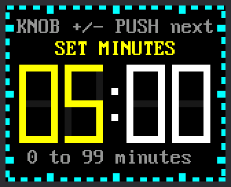
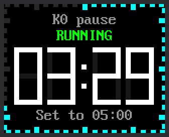
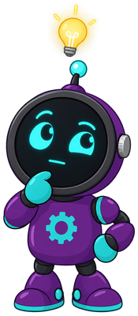

# Lab 16: Countdown Timer

{ width="336" }

A countdown timer runs **down** to zero, then sets off an alarm. Use it
for a homework break, a board game turn, or brushing your teeth. You set
the minutes and seconds with the knob. While it runs, the ticks around
the edge go out one by one.

| Control | What it does |
|---|---|
| **K0** | Start and pause |
| **Press the knob** | Set the time: minutes, then seconds, then done. While paused: reset. |
| **Turn the knob** | While setting: change the yellow number |

!!! mascot-welcome "Welcome to Lab 16"
    { class="mascot-admonition-img" }
    By the end of this lab, one button will start, pause and quiet your
    timer without ever getting mixed up. The idea behind it runs every
    video game you have played. Let's make time tick!

## What You Will Learn

- how one control can do different jobs at different times
- how to set a number by turning the knob
- how a timer knows how much time is left
- how a program flashes an alarm

## Run It

The timer starts at 05:00. Try a short one first.

1. Open `16-countdown-timer.py` in Thonny and click **Run**. The screen
   says `READY`.
2. Press the knob. The minutes turn yellow.
3. Turn the knob until the minutes read `00`. Clockwise adds, and
   counter-clockwise takes away.
4. Press the knob. Now the seconds are yellow. Turn them to `15`.
5. Press the knob once more. The screen says `READY` again.
6. Press **K0** to start. Watch the digits turn red for the last 10
   seconds.
7. At zero, press K0, press the knob, or turn the knob to stop the alarm.

| Setting the minutes | Counting down |
|---|---|
| { width="240" } | { width="240" } |

## One Control, Many Jobs

What does K0 do? It depends. When the timer is ready, K0 starts it.
While it runs, K0 pauses it.

The timer is always in exactly one **state**, such as ready, running or
paused. The state decides what each control does. A program built this
way is called a **state machine**. Video games work like this too: the
jump button does nothing while your character is already in the air.

This timer has six states. The screen shows the state's name above the
digits:

| State | K0 | Press the knob | Turn the knob |
|---|---|---|---|
| `READY` | start | set the time | nothing |
| `SET MINUTES` | nothing | go on to the seconds | change the minutes |
| `SET SECONDS` | nothing | done | change the seconds |
| `RUNNING` | pause | nothing | nothing |
| `PAUSED` | go on | reset | nothing |
| `TIME'S UP!` | stop the alarm | stop the alarm | stop the alarm |

The program keeps the state in one variable, `state`. On every pass of
the loop it asks "what state are we in?" before it looks at the controls.
The code calls the last state `DONE`.

```python
    elif state == READY:
        if k0_pressed and total_ms() > 0:
            end_ticks = time.ticks_add(now, remaining_ms)
            state = RUNNING
        elif push_pressed:
            state = SET_MINUTES
    elif state == RUNNING:
        remaining_ms = max(0, time.ticks_diff(end_ticks, now))
        if k0_pressed:
            state = PAUSED
        elif remaining_ms == 0:
            state = DONE
            done_at = now
```

- In `READY`, K0 changes the state to `RUNNING`, but only if the time is
  more than zero.
- In `RUNNING`, the very same K0 changes the state to `PAUSED`.
- When no time is left, the timer moves itself to `DONE`.

!!! mascot-thinking "States Are All Around You"
    { class="mascot-admonition-img" }
    Look for states in the gadgets around you. A microwave, a traffic
    light and a game controller all act differently in different states.
    When a button surprises you, ask which state the gadget was in.

## Know When It Will End

Like the stopwatch in [lab 15](15-stopwatch.md), the timer never counts.
It reads the same counter of **milliseconds**, or thousandths of a
second. The stopwatch remembered when it started. The timer works out
when it will **end**. Two lines in the code above do it:

- `time.ticks_add(now, remaining_ms)` adds the time left to `now`, the
  counter's reading. The answer, `end_ticks`, is the moment the timer
  will reach zero.
- `time.ticks_diff(end_ticks, now)` asks how far away that moment is. The
  loop asks again on every pass.

Say you start a 5-minute timer when the counter reads 40,000. Five
minutes is 300,000 milliseconds, so `end_ticks` is 340,000. Later the
counter reads 131,000. The time left is 340,000 − 131,000 = 209,000
milliseconds. That is 3 minutes and 29 seconds, as in the picture above.

## Whole Seconds and a Red Warning

Three lines decide what the digits show:

```python
        seconds_left = (remaining_ms + 999) // 1000
        warn = state == RUNNING and remaining_ms <= WARNING_MS
        color = WARNING_COLOR if warn else DIGIT_COLOR
```

- The first line turns milliseconds into whole seconds, rounding **up**.
  The `//` sign divides and drops the remainder. With 300 milliseconds
  left, (300 + 999) // 1000 is 1, so the screen still says `00:01`.
- `WARNING_MS` is 10,000. So `warn` is true for the last 10 seconds of a
  running timer.
- The last line picks red when `warn` is true, and white the rest of the
  time.

## The Alarm

At zero the state becomes `DONE`, and this code runs:

```python
        flash = (time.ticks_diff(now, done_at) // FLASH_MS) % 2 == 0
        if flash != shown_flash:
            for digit in digits:
                digit.show(DIGITS[0] if flash else BLANK, WARNING_COLOR)
            alarm_outputs(flash)
            shown_flash = flash
```

- `done_at` is the moment the timer reached zero. `FLASH_MS` is 500, so
  the first line counts the half seconds since then. `flash` is `True`
  on even counts and `False` on odd ones.
- When `flash` changes, each digit shows a red 0 or goes blank.
- `alarm_outputs(flash)` switches the Pico's onboard LED (light-emitting
  diode) on and off in step. That is the light you blinked in
  [lab 01](01-blink-onboard-led.md).

The kit has no buzzer, so the alarm is silent.

!!! note "Want a beep?"
    You can add a piezo buzzer, a tiny speaker that beeps. Wire its + leg
    to a free pin, such as GP15. Wire its − leg to a ground pin (GND).
    Then change `BUZZER_PIN = None` in `config.py` to `BUZZER_PIN = 15`.
    Nobody has tried this on a real kit yet, so you would be the first.

!!! tip "Try This"
    1. While you set the minutes, turn the knob back past `00`. What
       number comes next? Find `% 100` in the program to see why.
    2. Change `START_MINUTES = 5` to the number of minutes you use most.
    3. Change `WARNING_MS = 10_000` to `30_000`. When do the digits turn
       red now? (1,000 milliseconds is one second.)
    4. Change `FLASH_MS = 500` to `150`. How does the alarm feel now?

## If It Doesn't Work

- **K0 won't start the timer.** A timer set to `00:00` can't start. K0
  also does nothing while a number is yellow. Press the knob until the
  screen says `READY`.
- **Turning the knob does nothing.** The knob only changes a yellow
  number. Press the knob first.

!!! mascot-celebration "Six States, One Alarm!"
    { class="mascot-admonition-img" }
    You built a state machine with six states and a countdown that knows
    when it will end. Next comes the big finish: all five clock faces in
    one program.

**Next:** [Lab 17: One Clock, Five Modes](17-main-template.md)
