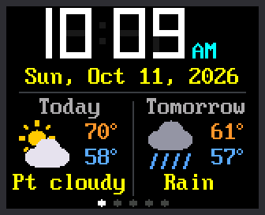
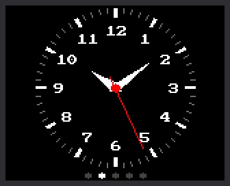
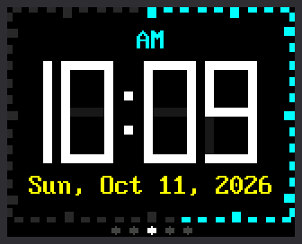
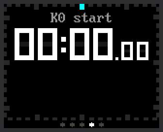
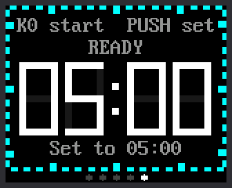

# Lab 17: One Clock, Five Modes

{ width="336" }

This is the big finish. Everything you have built comes together in
**one clock**. Turn the knob to move between its five faces, called
**modes**:

**Weather ↔ Analog ↔ Digital ↔ Stopwatch ↔ Timer**, and around again to
Weather.

Clockwise goes forward and counter-clockwise goes back. Five dots at the
bottom of the screen show where you are: the bright dot is your mode.

| Control | What it does |
|---|---|
| **Turn the knob** | Go to the next mode, or back to the one before |
| **K0** | Start and stop the stopwatch or the timer |
| **Press the knob** | Lap or reset in the stopwatch. Set or reset in the timer. |

!!! mascot-welcome "Welcome to Lab 17"
    { class="mascot-admonition-img" }
    You started with one blinking light, and now you have five clock
    faces. In this lab you'll join them into one clock that runs on its
    own, with no computer attached. Let's make time tick!

## What You Will Learn

- why a program should load only the part it needs
- how the main program and a mode share the knob
- how a stopwatch or a timer keeps going while you look elsewhere
- how to make the clock start by itself

## Run It

1. Open `17-main-template.py` in Thonny and click **Run**.
2. Wait while the screen says `Setting clock`. Then the Weather mode
   appears, and its forecast fills in a moment later.
3. Turn the knob one click clockwise. The analog face appears, and the
   second dot turns bright.
4. Keep turning to visit Digital, Stopwatch and Timer. One more click
   brings you back to Weather.
5. Turn the knob the other way to go back through the list.

| Weather | Analog | Digital | Stopwatch | Timer |
|---|---|---|---|---|
| { width="130" } | { width="130" } | { width="130" } | { width="130" } | { width="130" } |

## Each Mode Is a Module

Each mode lives in its own file, or **module**: `mode_weather.py`,
`mode_analog.py`, and so on. You met modules in
[chapter 17 of Learning Python](https://dmccreary.github.io/learning-python/chapters/17-modules-and-random/).
The main program lists the modes in the order the knob visits them:

```python
MODES = (
    ("mode_weather", "Weather"),
    ("mode_analog", "Analog"),
    ("mode_digital", "Digital"),
    ("mode_stopwatch", "Stopwatch"),
    ("mode_timer", "Timer"),
)
START_MODE = 0           # Weather
```

Each line pairs a module's name with a name to print in the shell.
Counting starts at 0, so `START_MODE = 0` means Weather.

Why not load all five at the start? They would fill the Pico's memory
with code and drawings nobody is looking at. Think of a desk with room
for one board game. Before you set up a new game, you pack the old one
back in its box.

So only the mode on the screen is in memory. When you turn the knob, the
main program does three things:

1. It asks the current mode to stop, and keeps whatever it hands back.
2. It removes that mode from memory. Then it runs the **garbage
   collector**, the part of MicroPython that frees unused memory.
3. It loads the next mode and asks it to start.

## Four Functions Every Mode Has

The main program doesn't know what a mode draws. It only knows that every
mode has the same four functions:

| Function | When the main program calls it | What the mode does |
|---|---|---|
| `start(display, k0, push, saved)` | once, when the mode is loaded | draws its whole screen |
| `update(now)` | on every pass of the loop | reads the buttons and redraws only what changed |
| `on_knob(clicks)` | when the knob turns (this one is optional) | returns `True` if it used the turn itself |
| `stop()` | when you switch away | turns off anything that is on, and hands back a note to keep |

It works like a game console: any cartridge plays, because they all fit
the same slot. This part of `switch_to()` plugs a mode in:

```python
    mode_index = index
    name = MODES[index][0]
    loaded_before = set(sys.modules)
    mode = __import__(name)
    mode.start(display, k0_button, push_button, saved.get(name))
```

- `MODES[index][0]` is the module's name, such as `"mode_analog"`.
- `loaded_before` lists what is in memory now, so the next switch knows
  what to remove.
- `__import__(name)` does the job of `import`, with the name taken from a
  variable.
- `mode.start(...)` hands the mode the screen, both buttons, and its
  saved note.

!!! note "For the curious: add a sixth mode"
    1. Save a copy of `mode_digital.py` on the Pico, named
       `mode_green.py`.
    2. In the copy, change `DIGIT_COLOR = config.WHITE` to
       `config.GREEN`.
    3. In the main program, add the line `("mode_green", "Green"),` after
       the Timer line in `MODES`.
    4. Run the main program and count the dots.

    Now change your mode as much as you like. Follow two rules. Stay out
    of the bottom 8 rows, where the dots go. Clear the screen only in
    `start()`.

## Who Owns the Knob?

The knob belongs to the main program, so a turn means the same thing in
every mode: switch. But the timer needs the knob too, to set its minutes
and seconds. So the main program asks the mode first:

```python
    clicks = knob.turned()
    if clicks:
        on_knob = getattr(mode, "on_knob", None)
        used = on_knob is not None and on_knob(clicks)
        if not used:
            step = 1 if clicks > 0 else -1
            switch_to((mode_index + step) % len(MODES))
```

- `knob.turned()` gives the clicks since the last pass. Clockwise is a
  positive number.
- `getattr(mode, "on_knob", None)` looks in the mode for a function named
  `on_knob`. If there is none, it gives `None`.
- `used` is `True` only when the mode has `on_knob()` and it answers
  `True`.
- `step` is 1 for forward and -1 for back. The `%` wraps around the ends
  of the list. From Timer, which is mode 4, forward is (4 + 1) % 5 = 0.
  That is Weather.

Only the timer has `on_knob()`. It answers `True` while you set the time
and while its alarm flashes. So you can't fall out of the timer halfway
through setting it.

## Modes That Keep Going

Start the stopwatch, then turn to the weather. The stopwatch's module is
removed from memory. Yet when you turn back, it shows the right time.
How? When a mode stops, it hands the main program a note to keep:

```python
def stop():
    """Keep everything, so a running stopwatch keeps running."""
    return {"state": state, "run_started": run_started, "banked_ms": banked_ms,
            "laps": laps, "lap_started_ms": lap_started_ms}
```

The note is a **dictionary**, a set of values that each have a name. One
of them is `run_started`, the moment the stopwatch began. When the mode
loads again, `start()` gets the note back as `saved`. The millisecond
counter never stopped, so "now minus `run_started`" is still right.

A running timer adds one more thing to its note:

```python
    if state == RUNNING:
        saved["wake_at"] = end_ticks
```

`wake_at` means "show me again at this moment". The main program checks
the notes on every pass of its loop. When the moment comes, it switches
to the timer by itself, and the alarm goes off.

!!! mascot-thinking "Nothing Was Counting"
    { class="mascot-admonition-img" }
    Notice that nothing was counting while you were away. The stopwatch
    kept one number, the moment it started, and that was enough. A
    program that remembers moments can be packed away and brought back.

## Make It Start by Itself

So far, Thonny has started every program. But each time the Pico gets
power, MicroPython looks for a file named `main.py` and runs it. So save
a copy of this program on the Pico with that name:

1. Open `17-main-template.py` in Thonny.
2. Choose **File**, then **Save copy...**.
3. When Thonny asks where to save, pick **Raspberry Pi Pico**.
4. Type `main.py` as the file name and click **OK**.
5. Unplug the Pico from your computer. Plug its cable into a phone
   charger or a battery pack.

The clock starts by itself. With no computer attached, Thonny can't set
the time. WiFi is now the only way the clock can learn it, so
`secrets.py` must be on the Pico.

!!! mascot-tip "Getting Thonny Back"
    { class="mascot-admonition-img" }
    The clock now starts every time the Pico gets power, even when you
    plug it into your computer. Click **Stop** in Thonny to end it before
    you run another lab. To switch this off for good, choose **View**,
    then **Files**, right-click `main.py` on the Pico, and choose
    **Delete**.

!!! tip "Try This"
    1. Change `START_MODE = 0` to `START_MODE = 2`. Which mode comes up
       first?
    2. Start the stopwatch, turn to the weather, count to ten, and turn
       back. Is the time right?
    3. Set the timer to 20 seconds and start it. Turn to the analog face
       and wait. What happens at zero?
    4. Take the line `("mode_analog", "Analog"),` out of `MODES`. How
       many dots are there now?

## If It Doesn't Work

- **Turning the knob changes the timer's numbers, not the mode.** You are
  setting the timer. Press the knob until the screen says `READY`, then
  turn.
- **The clock jumps to the timer by itself.** A timer you started has
  reached zero. Press K0 or the knob to stop the alarm.
- **On a charger, the clock shows the wrong time.** It could not join
  your WiFi. Check `secrets.py`, and keep the clock within reach of your
  WiFi.

!!! mascot-celebration "You Built a Five-Mode Clock!"
    { class="mascot-admonition-img" }
    You joined five faces into one program that loads only the mode it
    needs. It shares one knob, and it keeps a stopwatch and a timer going
    out of sight. That is how real gadget software is built!

**You have finished all 17 labs.** Go back to the
[kit's main page](index.md), or invent a sixth mode of your own.
