# Knob Clock Kit

**Build a desk clock with a color screen and a knob, and write every line
of its code yourself.**

{ width="640" }

*The real kit, running the five-mode clock from lab 17. This is its
weather mode.*

This clock is a tiny computer with a bright color screen. It has one knob
that you can turn **and** press, and one push button. You write the
programs that make it tick. You start by blinking a light, and you finish
with a clock that has five different faces.

**Ages 10 and up. You only need to know a little Python.**

## What Your Clock Will Do

- **Set its own time.** It asks the internet what time it is.
- **Show the time your way.** Choose big digital numbers, or a clock face
  with moving hands.
- **Tell you the weather.** Today's and tomorrow's forecast appear with
  little pictures of sun, clouds, rain, and snow.
- **Time laps and count down.** It works as a stopwatch that records
  laps. It is also a countdown timer with a flashing alarm.
- **Switch with a turn of the knob.** Turn the knob to step through all
  five faces.

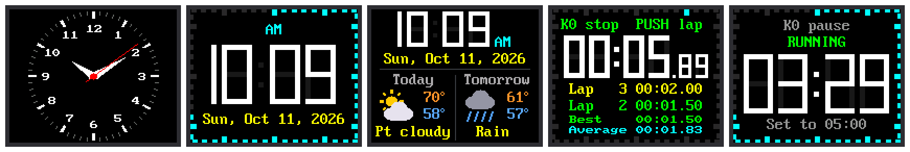

*These five pictures were drawn by running the labs' real code in a
simulator of the screen. So were the screen pictures in every lab.*

!!! mascot-welcome "Meet Chrono"
    { class="mascot-admonition-img" }
    Hi, I'm Chrono, a robot whose head is a screen a lot like the one
    you're about to program. By the end of these labs you'll have a clock
    that you built, running code that you understand. I'll pop up with
    tips, warnings about traps, and a cheer when you finish. Let's make
    time tick!

## How It Works

There are 17 short labs, numbered 01 to 17. Each lab is one program. Each
one teaches a new idea that you use in the labs after it.

1. **Wake it up (labs 01–03).** Blink a light, give the kit a checkup,
   and say hello on the screen.
2. **Meet the controls (labs 04–08).** Test the button, the knob, and the
   screen's light, one part at a time.
3. **Make it a clock (labs 09–13).** Show the time and set it from the
   internet. Build a face with moving hands, and set the time with the
   knob.
4. **Make it smart (labs 14–17).** Fetch the weather, and add a stopwatch
   and a timer. Then put it all together into one clock with five modes.

Do the labs in order. Each one ends with something new on the screen or
in the shell.

## What You Should Know First

These labs are for people who are new to Python but have made a start.
You are ready if you have finished one of these free courses:

- [Learning Python](https://dmccreary.github.io/learning-python/), where
  you write Python in a web browser.
- [Learning MicroPython](https://dmccreary.github.io/learning-micropython/),
  where you program a Pico and wire up parts on a breadboard.

Here are the ideas the labs lean on most. If one feels rusty, the link
takes you back to where it was taught.

| Idea | Where to review it |
|---|---|
| Variables and numbers | [Learning Python, chapter 3](https://dmccreary.github.io/learning-python/chapters/03-variables-and-numbers/) |
| `if` and `else` | [Learning Python, chapter 9](https://dmccreary.github.io/learning-python/chapters/09-decisions-if-else/) |
| `while` loops | [Learning Python, chapter 10](https://dmccreary.github.io/learning-python/chapters/10-while-loops-and-animation/) |
| Functions | [Learning Python, chapter 11](https://dmccreary.github.io/learning-python/chapters/11-functions-parameters-scope/) |
| `import` and modules | [Learning Python, chapter 17](https://dmccreary.github.io/learning-python/chapters/17-modules-and-random/) |
| Blinking a light on a Pico | [Learning MicroPython: Blink](https://dmccreary.github.io/learning-micropython/basics/01-blink/) |
| Reading a button | [Learning MicroPython: Buttons](https://dmccreary.github.io/learning-micropython/basics/03-button/) |
| Using a breadboard | [Learning MicroPython: Breadboards](https://dmccreary.github.io/learning-micropython/hands-on-labs/05-electronics-fundamentals/breadboards/) |

## What's in the Kit

| Part | What it does |
|---|---|
| **Raspberry Pi Pico 2 W** | The brain of the clock. It is a **microcontroller**, a tiny computer on a board about the size of a stick of gum. The **W** means it has WiFi, so it can talk to the internet. |
| **Display board** | The clock's face, with its controls built in. The board is labeled "1.8 TFT + EC11". |
| **Color screen** | Part of the display board. It is 1.8 inches from corner to corner and has 160 × 128 tiny dots of light called **pixels**. A chip called the **ST7735S** turns the Pico's messages into pictures. |
| **Knob** | Part of the display board. You can turn it either way, and you can press it like a button. Its proper name is a **rotary encoder**. |
| **K0 button** | Part of the display board. A square push button below the knob. |
| **Breadboard and wires** | Connect the Pico to the display board. |
| **USB cable** | Gives the Pico power, and lets your computer send it programs. |

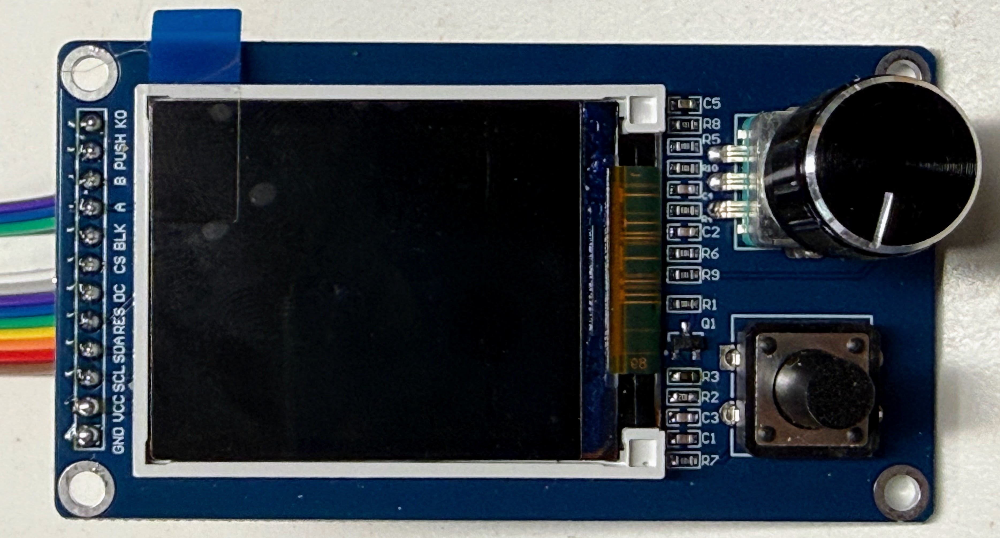{ width="480" }

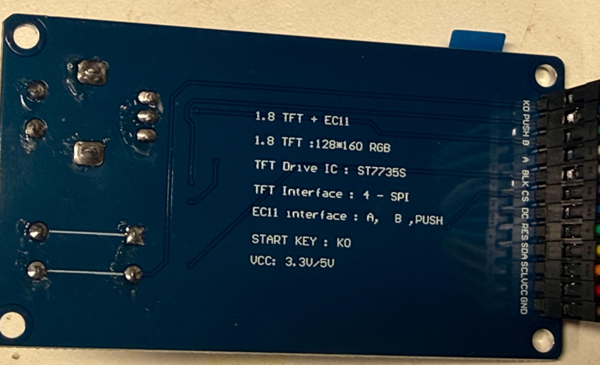{ width="480" }

## How the Controls Work

Every lab uses the three controls the same way, so you only learn it
once.

| Control | What it usually does |
|---|---|
| **K0** (the square button) | Starts and stops things |
| **Press the knob** | The second job: record a lap, reset, or move to the next number |
| **Turn the knob** | Makes a number go up or down. In lab 17, it changes the clock's face |

In the programs, pressing the knob is called **PUSH**.

## How It Is Wired

The display board has a row of 12 pins along one edge. Hold the board
with the knob on the right. Reading from the bottom pin up to the top
pin, the labels are: **GND VCC SCL SDA RES DC CS BLK A B PUSH K0**.

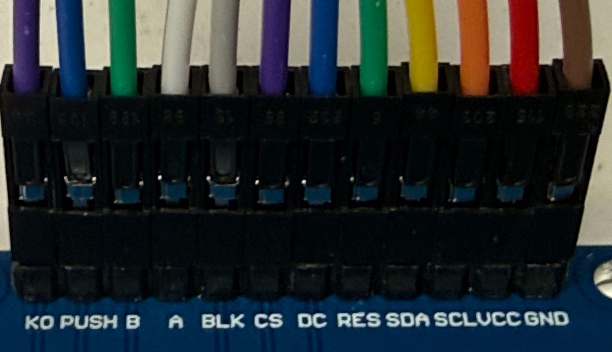{ width="480" }

Each pin connects to one pin on the Pico. The wire colors below are the
ones in the photos. Your colors may be different, and that is fine. What
matters is where each wire goes.

| Display pin | Pico pin | Wire color in the photos | What it carries |
|---|---|---|---|
| GND | GND | brown | Ground, the "minus" side of the power |
| VCC | 3V3 | red | Power, 3.3 volts |
| SCL | GP2 | orange | The clock beat that keeps the Pico and screen in step |
| SDA | GP3 | yellow | The data: the colors of the pixels |
| RES | GP4 | green | Reset: tells the screen to start fresh |
| DC | GP5 | blue | Says whether the next data is a command or a picture |
| CS | GP6 | purple | "Hey screen, I'm talking to you!" |
| BLK | GP7 | gray | The backlight that makes the screen glow |
| A | GP8 | white | One of the knob's two turning signals |
| B | GP9 | green | The knob's other turning signal |
| PUSH | GP10 | blue | The switch you close by pressing the knob |
| K0 | GP11 | purple | The square push button |

Follow these steps to wire it. Unplug the USB cable first.

1. Push the Pico into the breadboard so that it sits across the gap down
   the middle.
2. Find the Pico pin labeled **3V3**. Connect it to the display's **VCC**
   pin.
3. Connect any Pico pin labeled **GND** to the display's **GND** pin.
4. Connect **SCL**, **SDA**, **RES**, and **DC** to **GP2**, **GP3**,
   **GP4**, and **GP5**. These four Pico pins are next to each other.
5. Skip the next Pico pin. It is a ground pin, not GP6.
6. Connect **CS**, **BLK**, **A**, and **B** to **GP6**, **GP7**, **GP8**,
   and **GP9**.
7. Skip the next Pico pin. It is another ground pin.
8. Connect **PUSH** and **K0** to **GP10** and **GP11**.
9. Check every wire against the table before you plug in the USB cable.

!!! mascot-warning "Use 3V3, not 5 volts"
    { class="mascot-admonition-img" }
    The display's VCC wire must go to the Pico's **3V3** pin, never to
    **VSYS** or **VBUS**. Those two carry about 5 volts, which can damage
    the Pico through this board. Read the label twice before you plug
    in.

The Pico's pin names are printed on the bottom of the board. A pinout
picture helps too. Learning MicroPython has
[a page about the Pico](https://dmccreary.github.io/learning-micropython/hands-on-labs/04-microcontrollers-hardware/pi-pico/)
that shows every pin.

## Before You Start

You only need to do these steps once.

1. **Put MicroPython on the Pico.** MicroPython is the version of the
   Python language that runs on small boards like the Pico. Use the
   version made for the
   [Pico 2 W](https://micropython.org/download/RPI_PICO2_W/). The version
   for the plain Pico 2 has no WiFi.
2. **Install Thonny.** [Thonny](https://thonny.org) is the program you
   use to write code and send it to the Pico.
3. **Copy the kit's files onto the Pico.** The labs need helper files in
   a folder called `lib` on the Pico. They also need a settings file
   called `config.py`. Your teacher may have done this for you. If not,
   the kit folder has a script called `upload-code.sh` that copies
   everything at once.
4. **Tell the clock about your WiFi.** Copy the file
   `secrets-template.py` to a new file called `secrets.py`. Type in your
   WiFi network's name and password. Labs 10, 11, 13, 14, and 17 use it.
   The file `secrets.py` is kept private: it never gets shared online.
5. **Tell the clock your time zone.** Open `config.py` and find
   `TIMEZONE_HOURS`. Use -5 for Eastern time, -6 for Central, -7 for
   Mountain, or -8 for Pacific.

## The Labs

Click a lab number or a picture to open that lab.

| Lab | | What you will do |
|---|---|---|
| [01](01-blink-onboard-led.md) | [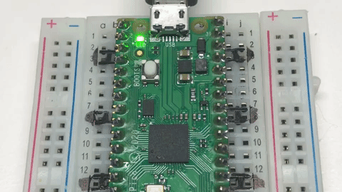{ width="110" }](01-blink-onboard-led.md) | Make a tiny light on the Pico blink, to check that the Pico works |
| [02](02-probe.md) | [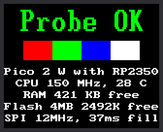{ width="110" }](02-probe.md) | Give the whole kit a checkup, like a doctor's visit |
| [03](03-hello-world.md) | [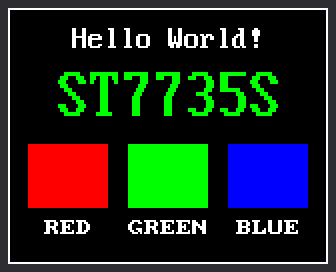{ width="110" }](03-hello-world.md) | Say hello on the screen |
| [04](04-button-test.md) | prints to the shell | Test the K0 button |
| [05](05-encoder-push-test.md) | prints to the shell | Test pressing the knob |
| [06](06-encoder-rotation-test.md) | prints to the shell | Test turning the knob, and learn how a knob knows which way it turned |
| [07](07-controls-display-test.md) | [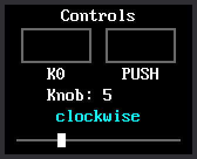{ width="110" }](07-controls-display-test.md) | See the button and the knob on the screen |
| [08](08-backlight-test.md) | [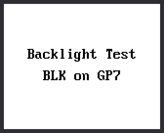{ width="110" }](08-backlight-test.md) | Switch the screen's light off and on |
| [09](09-digital-clock.md) | [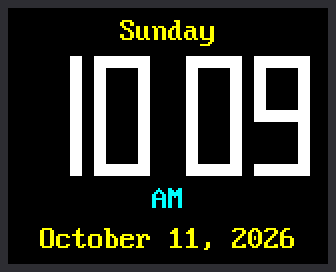{ width="110" }](09-digital-clock.md) | Show the time, day, and date in big digits |
| [10](10-wifi-sync-time.md) | [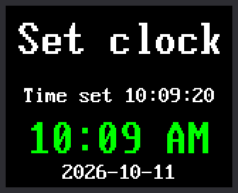{ width="110" }](10-wifi-sync-time.md) | Ask the internet what time it is |
| [11](11-analog-clock-face.md) | [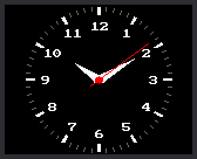{ width="110" }](11-analog-clock-face.md) | Build a clock face with moving hands |
| [12](12-set-time.md) | [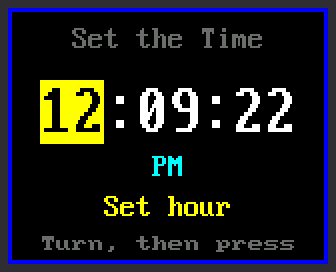{ width="110" }](12-set-time.md) | Set the time with the knob |
| [13](13-digital-clock-face.md) | [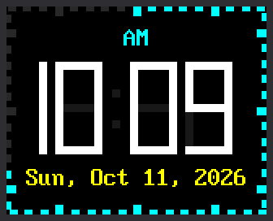{ width="110" }](13-digital-clock-face.md) | Build a digital face that repaints only what changes |
| [14](14-weather-clock.md) | [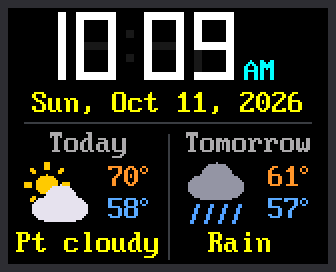{ width="110" }](14-weather-clock.md) | Add the weather forecast |
| [15](15-stopwatch.md) | [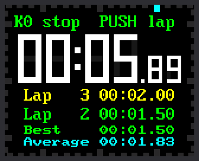{ width="110" }](15-stopwatch.md) | Make a stopwatch that times laps |
| [16](16-countdown-timer.md) | [{ width="110" }](16-countdown-timer.md) | Make a countdown timer with an alarm |
| [17](17-main-template.md) | [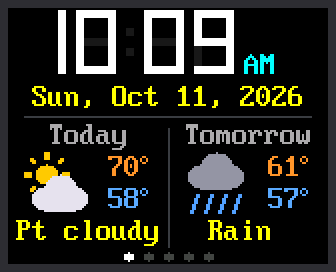{ width="110" }](17-main-template.md) | Put it all together into one clock with five modes |

!!! mascot-tip "Which program is running?"
    { class="mascot-admonition-img" }
    Every lab prints its name and version number in Thonny's shell when
    it starts, like `11-analog-clock-face.py v1.0`. If the screen isn't
    doing what you expect, check that line first. It tells you which
    program the Pico is really running.

## Words to Know

| Word | What it means |
|---|---|
| **Pixel** | One tiny dot of light on the screen. This screen has 160 × 128 = 20,480 of them. |
| **Microcontroller** | A small computer built to control one thing, like a clock, a toy, or a microwave. |
| **Program** | A list of instructions for a computer, written in a language like Python. |
| **Loop** | Part of a program that repeats over and over. A clock's program runs in a loop forever. |
| **Variable** | A name that holds a value, like `second = 42`. |
| **Function** | A named set of instructions you can use again and again, like `draw_digit()`. |
| **Module** | A file of Python code that other programs can borrow from with `import`. |
| **Rotary encoder** | A knob that tells the computer which way it turned, and how far. |
| **Shell** | The box at the bottom of Thonny where a program's printed messages appear. |
| **WiFi** | A way for devices to connect to the internet without wires. |

## For Parents and Teachers

- **What a student learns:** Python programming, how a computer reads a
  knob and draws to a screen, how a clock keeps time, and how a device
  gets data from the internet.
- **One-time setup by an adult:** the display board's 12 pins come as a
  loose strip and must be soldered on once. After that, everything plugs
  together with wires.
- **Privacy:** the clock has no microphone and no camera. It connects to
  WiFi only to get the time and a public weather forecast.
- **What it costs:** the display board, with its knob and button, was
  $5.53 on AliExpress in October 2026. You also need a Pico 2 W, a
  breadboard, twelve jumper wires, and a USB cable.

The [Notes for Teachers](teacher-notes.md) page has the details. It
covers where to buy the parts, the screen's driver, how fast the
hardware really is, and how each clock face avoids flicker. It also says
what was tested on a real kit, and it has a troubleshooting table.
