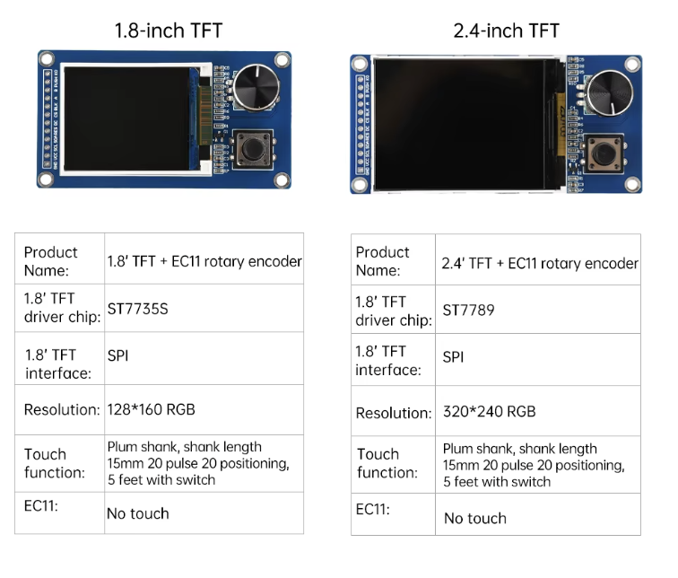

# Notes for Teachers

These notes are for the adult running the [Knob Clock Kit](index.md):
what the parts are, what was measured on a real kit, how the programs
are built, and what to do when something goes wrong. Students do not
need this page.

Everything here was checked against one working kit: a Raspberry Pi
Pico 2 W running MicroPython 1.29.0, wired to a "1.8 TFT + EC11" display
board. Where something was not tested, this page says so.

## Who the Labs Are For

The labs are written for a reader of about 11 who is new to Python and
has finished [Learning Python](https://dmccreary.github.io/learning-python/)
or [Learning MicroPython](https://dmccreary.github.io/learning-micropython/).
The kit's [main page](index.md#what-you-should-know-first) lists the
ideas the labs lean on, with links back to where each one is taught.

The labs get harder in steps:

| Labs | What they do | New ideas |
|---|---|---|
| 01–03 | Blink, kit checkup, hello on the screen | Running a program, coordinates, fonts |
| 04–08 | Test each control and the backlight, one at a time | Pull-ups, how the knob works, interrupts |
| 09–13 | Clocks: digital, WiFi time, analog, setting by hand | 12-hour time, time zones, redrawing only what changed, bounce |
| 14–17 | Weather, stopwatch, timer, five modes in one program | Web requests, timing from a clock, state machines, modules |

Labs 04, 05, and 06 only print to the Thonny shell. That is on purpose:
each control is proven alone before the screen is added in lab 07. If a
later lab misbehaves, the student already knows which part works.

No timings are given, because the labs have not been run with a class
yet. Labs 01–08 are short. Labs 11, 13, and 17 carry the hardest ideas
and deserve a session each.

## Sourcing Parts

Prices on these parts change every week, and single listings come and
go. Treat the prices below as a guide to what to expect.

### The display board

The display, the knob, and the K0 button are all on one board. We bought
ours on AliExpress. This was the listing in October 2026:

{ width="640" }

To find it, search AliExpress for **1.8 TFT EC11 rotary encoder**. Three
things to notice before you order:

- **Choose the 1.8 inch size.** The same listing sells a 2.4 inch board,
  for $7.02 that day. It looks the same, but it has a different chip
  (ST7789) and a 320 × 240 screen. This kit's driver and labs are written
  for the 1.8 inch board and will not work on the larger one.
- **The pins come loose.** The photo shows the 12-pin header as a
  separate strip. It has to be soldered to the board before the first
  lab. That is the only soldering in the kit.
- **The price is for one board, before shipping.**

The listing's own table shows the two sizes side by side:

{ width="480" }

The table says the knob has "20 pulse 20 positioning". On the test kit,
one click of the knob was two steps of its A and B lines, not four (see
[The Knob and the Buttons](#the-knob-and-the-buttons)). Trust what lab
06 prints over what the listing says.

The back of the board is printed with the same facts: `128*160 RGB`,
`TFT Drive IC: ST7735S`, `4-SPI`, `EC11 interface: A, B, PUSH`,
`START KEY: K0`, and `VCC: 3.3V/5V`.

### The Pico, the wires, and the USB cable

These are the same parts the Chrono Smart Clock Kit uses, and its
[sourcing notes](../sw-gc9b72/teacher-notes.md#sourcing-parts) cover
where to buy them. Two things differ for this kit:

- **The Pico.** These labs were only tested on a Pico 2 W. Flash the
  `RPI_PICO2_W` build of MicroPython; the plain `RPI_PICO2` build has no
  WiFi.
- **The wires.** This display needs twelve Male-Female jumper wires, not
  eight. The wire colors in the kit's
  [wiring table](index.md#how-it-is-wired) come from our build, which
  used a nine-wire piece of ribbon and a three-wire piece.

## Wiring Cautions

- **Power the board from 3V3.** The board accepts 5 volts, but its
  button and knob lines would then rest at 5 volts, and the Pico's pins
  are not built for that.
- **The wires do not go to twelve pins in a row.** GP2 to GP11 have two
  ground pins among them, after GP5 and after GP9. A student who plugs
  the ribbon straight in puts CS on a ground pin. The screen still
  draws, because CS is active when low, but every wire after it is one
  pin off. The symptom is a working picture with a dead knob and button.
- **CS was never tested alone.** Every other wire was confirmed by a lab.
  CS sits between two confirmed pins.

## What the Kit Checkup Reports

Lab 02 prints a ten-part report and draws a summary. On the test kit it
reported:

| Item | Value |
|---|---|
| Processor | RP2350, running its two ARM Cortex-M33 cores at 150 MHz |
| Firmware | MicroPython 1.29.0, `RPI_PICO2_W` build |
| RAM | 436 KB of heap, about 421 KB free at start |
| Flash | 4 MB chip, 2.5 MB of it for files |
| SPI | Asked for 12 MHz, got 12 MHz |
| Display start-up | About 660 ms, most of it the controller's own required waits |
| Full-screen fill | 37 ms, so at most about 27 full redraws a second |

A full-screen picture needs 160 × 128 × 2 = 40,960 bytes, so a frame
buffer would fit in RAM easily. The labs still draw straight to the
screen, because that is how the sibling
[Chrono Smart Clock Kit](../sw-gc9b72/index.md) works, and its labs were
the model for these.

## The Driver

The driver is `lib/st7735s.py`. It was written for this kit so that it
has the same method names as the Chrono kit's driver: `fill`,
`fill_rect`, `hline`, `vline`, `rect`, `pixel`, `line`, `blit_buffer`,
and `text(font, text, x, y, color, background)`. That is why the Chrono
kit's fonts, `shapes.py`, and most of `watchparts.py` work here
unchanged.

Three settings in `config.py` vary between ST7735 boards. All three were
confirmed on the test kit:

| Setting | Value | How it was confirmed |
|---|---|---|
| `ROTATION` | 1 | The picture is upright with the knob on the right |
| `BGR` | False | Lab 02's bars come out red, green, blue |
| `X_OFFSET`, `Y_OFFSET` | 0, 0 | Lab 03's white border is complete on all four sides |

The SPI clock is 12 MHz. The ST7735S data sheet rates its write clock at
about 15 MHz, and MicroPython on this board can make 8, 12, or 24 MHz
near that figure, so 12 is the fastest setting inside the limit.

There is no frame buffer and no `show()`. Every drawing call sends
pixels at once. A line at an angle is drawn one pixel at a time, and
each pixel is its own message to the screen, so slanted lines are the
slowest thing the driver draws.

## The Knob and the Buttons

The knob is an EC11 rotary encoder. Its A and B outputs step through
four positions as it turns. On this board one click is **two** steps: the
knob rests with A and B both 1, and one click later with both 0. That
is `ENCODER_STEPS_PER_CLICK = 2` in `config.py`. Many EC11 knobs take
four steps a click, so check this if you swap the board for another
kind. Lab 06 prints every step and says what to change.

Lab 06 reads the knob in a loop, 1000 times a second. On the test kit
it counted 550 steps without missing one. A loop like that starts to
miss steps once the program is also busy drawing, so from lab 07 on the
knob is read by interrupts on both edges of A and B, packaged as the
`Knob` class in `lib/watchparts.py`.

PUSH and K0 read 1 at rest and 0 when pressed. The `Button` class in
`lib/watchparts.py` handles bounce, and uses an interrupt so that a
quick tap is not lost while the program is busy drawing.

The controls follow one rule in every lab, which is worth saying out
loud to a class: K0 starts and stops, pressing the knob is the second
job, and turning the knob changes a number.

## How the Clock Faces Avoid Flicker

With no frame buffer, anything cleared and redrawn blinks. Each face
solves that in its own way, and these are the main ideas of the later
labs:

- **Lab 09** redraws a whole digit, but only when that digit changes.
- **Lab 11** draws the dial once. Each second it erases the old hands by
  drawing them in black, redraws the one numeral the second hand
  crossed, and draws the new hands. The dial is laid out so that the
  hands can never reach the ticks.
- **Lab 13** treats each digit as 13 small rectangles. It repaints only
  the rectangles that differ between the old digit and the new one. In
  the simulator, a normal second sends about 65 pixels out of 20,480.
- **Lab 14** draws each weather icon off-screen in a 32 × 32 frame
  buffer, then sends it in one piece.

The round Chrono kit has a ring of 60 seconds ticks around its rim.
Here the ticks run around the edge of the rectangle instead, starting at
the middle of the top edge. Ticks 15, 30, and 45 land at the middle of
the right, bottom, and left edges, where 3, 6, and 9 o'clock would be.

## WiFi and the Time

- The Pico 2 W joins 2.4 GHz networks only.
- `secrets.py` holds the network name and password. It is in the
  repository's `.gitignore`, and `upload-code.sh` copies it to the Pico.
- **Joins sometimes fail on the first try.** In testing, about one first
  try in three failed, even with the right password. `wifi_time.py`
  tries up to three times, with a short rest between tries. A student
  may see `Try 1 failed` in the shell and then success. That is normal.
- Time servers give UTC. `TIMEZONE_HOURS` and `USE_US_DST` in
  `config.py` turn it into local time. On the test kit the result
  matched a computer's clock to the second.
- The Pico has no battery-backed clock. The time is lost when it is
  unplugged, and the clock faces set it again over WiFi at power-up.
- When WiFi is down, a clock face stands still while it tries to
  connect. That can last 10 seconds or more each time.

## The Weather

`forecast.py` asks [Open-Meteo](https://open-meteo.com), a free service
that needs no account and no key. The reply holds two days of highs,
lows, and weather codes. `LATITUDE`, `LONGITUDE`, and `TEMPERATURE_UNIT`
in `config.py` choose the place and the units. The kit ships set to
Minneapolis and fahrenheit.

The weather clock gets a new forecast every 30 minutes. If a request
fails, it keeps the old forecast and tries again every 5 minutes.

## Stopwatch, Timer, and the Five Modes

Neither the stopwatch nor the timer counts by adding a little each time
round the loop. Both work from the Pico's millisecond clock, so slow
drawing never makes them drift.

The timer is a state machine with six states. Its alarm flashes 00:00
and the Pico's onboard LED. **The kit has no buzzer.** `BUZZER_PIN` in
`config.py` is `None`, and the buzzer code path has never been run.

Lab 17 loads one mode at a time, as a module, and unloads it when the
knob is turned. In Weather mode the test kit reported 390 KB of RAM
free. Each mode draws only in rows 0 to 119. The bottom 8 rows belong to
the main program, which draws the five mode dots there.

A stopwatch or timer left running keeps running in another mode,
because its time comes from the millisecond clock. A running timer asks
to be shown again when it ends, so its alarm appears whatever face is on
the screen.

To make the clock start by itself at power-up, save a copy of
`17-main-template.py` on the Pico with the name `main.py`.

## What Was and Was Not Tested

Every lab was run on the test kit without errors. The person who built
the kit also watched the screen and worked the controls for:

- lab 06 (turning the knob) and lab 12 (setting the time)
- lab 17, stepping through all five modes
- the first versions of labs 02, 03, 07, and 08, before the driver was
  rewritten

The other labs were checked in the simulator and started on the kit,
but nobody has yet looked closely at their screens on real hardware.

Not tested on real hardware:

- the buzzer path in the timer
- any board other than a Pico 2 W
- how the dim "ghost" segments and unlit ticks look in a bright room
- a full class of students

## How the Pictures Were Made

The photos on the main page are of the real kit. Every other screen
picture was made by running the lab's real code in a simulator of the
screen, so the pictures show what the code draws. The simulator does
not copy the real screen's colors or speed.

To make the pictures again after changing a lab, run this from the top
of the repository:

```bash
python3 src/display-simulators/st7735s/render_rect_tft_docs.py
```

## Troubleshooting

| What you see | What to check |
|---|---|
| Nothing appears in the shell when a lab starts | Thonny is not connected to the Pico. Every lab prints its name and version first. |
| `ImportError: no module named 'st7735s'` (or a font name) | The `lib` folder is not on the Pico. Run `upload-code.sh`, or copy `lib` with Thonny. |
| `upload-code.sh` says the port is in use | Thonny is still connected. Stop or quit it first. |
| The screen stays dark | Check VCC is on 3V3 and GND is on a ground pin. Run lab 08 to test the backlight wire. |
| The screen lights up but stays blank or shows specks | Check SCL, SDA, RES, and DC against the wiring table. |
| The picture works, but the knob and button do nothing | The wires after DC are probably one pin off. See [Wiring Cautions](#wiring-cautions). |
| The picture is upside down | Change `ROTATION` to 3 in `config.py`. |
| Red and blue are swapped | Change `BGR` to `True` in `config.py`. |
| The knob counts the wrong way | Swap `ENCODER_A_PIN` and `ENCODER_B_PIN` in `config.py`. |
| The count moves two at a time, or every second click | Change `ENCODER_STEPS_PER_CLICK`. Lab 06 shows the steps. |
| `Try 1 failed` when joining WiFi | Normal now and then. It tries three times. |
| WiFi never joins | Check the name and password in `secrets.py`, and that the network is 2.4 GHz. |
| The time is wrong by whole hours | Check `TIMEZONE_HOURS` and `USE_US_DST` in `config.py`. |
| The time resets after unplugging | Expected. Run lab 10, or use a face that sets its own time. |
| The weather shows `--` | The forecast request failed. It tries again by itself in 5 minutes. |
