# List of MicroSims for Clocks and Watches with AI

Interactive MicroSims to help students learn how clocks and watches work, from binary counting and seven-segment displays to shift registers and analog clock faces.

-   **[Accuracy vs Precision Targets](./accuracy-vs-precision/index.md)**

    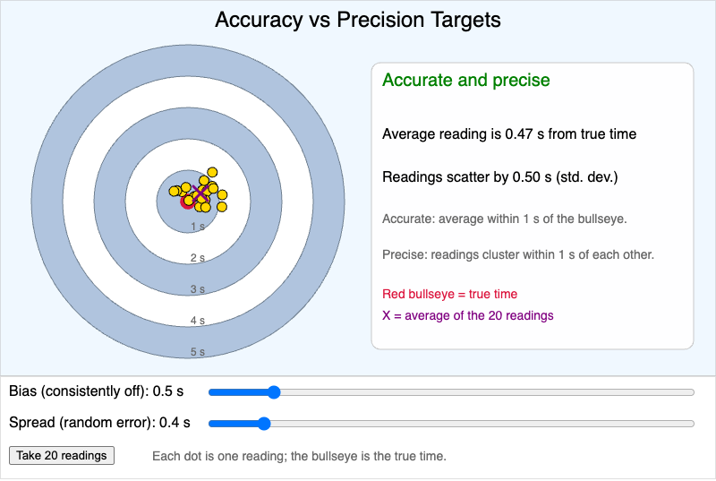

    A dartboard target where the bullseye is the true time and each dot is a clock reading. Bias and spread sliders show the difference between an accurate clock and a precise one.

-   **[Alarm State Machine](./alarm-state-machine/index.md)**

    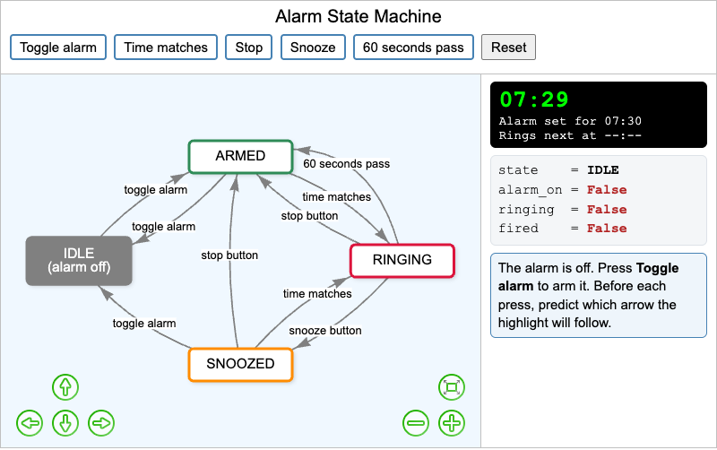

    Press alarm events and watch an alarm clock's state machine move between IDLE, ARMED, RINGING and SNOOZED while a small clock model and the alarm_on, ringing and fired variables update.

-   **[Analog Clock](./analog-clock/index.md)**

    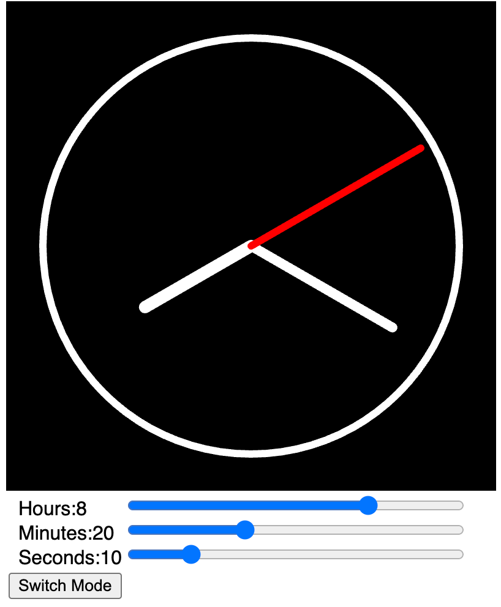

    Interactive p5.js analog clock simulation with manual and automatic modes, demonstrating trigonometric functions for hand positioning

-   **[Analog Watch Face Builder](./analog-watch-face-builder/index.md)**

    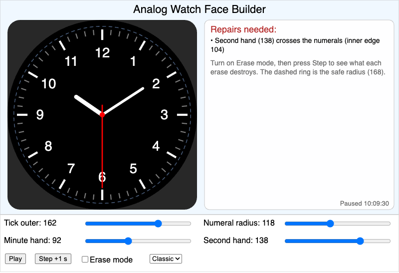

    Design an analog face for a 360 by 360 round display by choosing tick, numeral, and hand radii and a color palette, then use Erase mode to see which pixels an erased second hand destroys and which repairs the layout needs.

-   **[Architectural Levels Zoom](./architectural-levels/index.md)**

    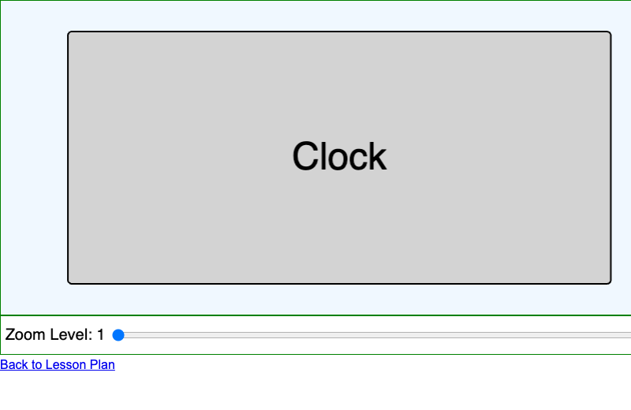

    Interactive visualization showing progressive zoom levels of clock system architecture from high-level to component details

-   **[Battery Drain](./battery-drain/index.md)**

    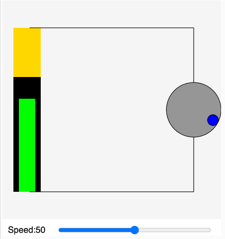

    Interactive p5.js simulation demonstrating battery discharge rates when powering a motor at different speeds

-   **[Battery Life Calculator](./battery-life-calculator/index.md)**

    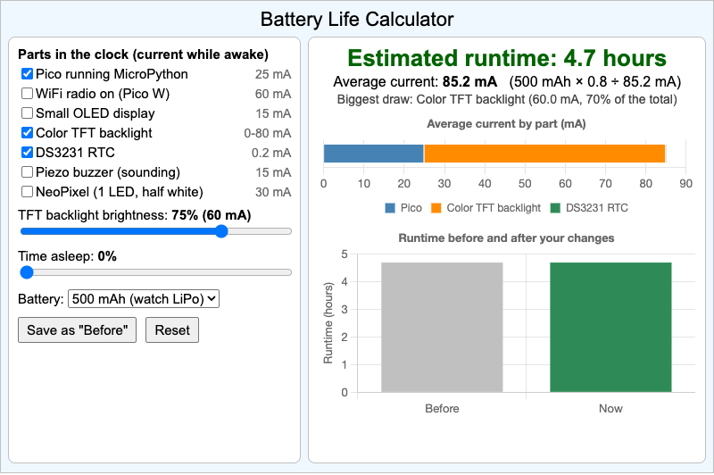

    Choose a clock's parts, backlight brightness, sleep time and battery, then compare the estimated runtime before and after your design changes.

-   **[BCD Converter](./bcd-converter/index.md)**

    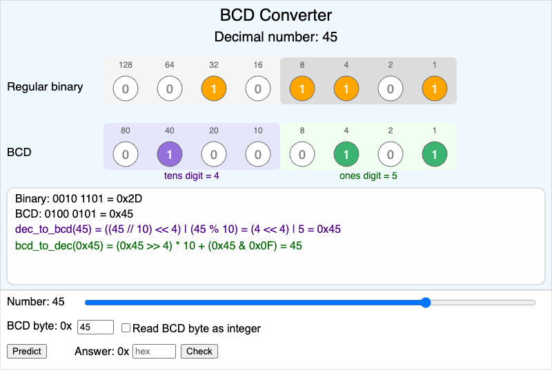

    Compare ordinary binary with BCD for the numbers 0 to 59, decode raw RTC register bytes, see the read-as-integer mistake, and practice encoding numbers as BCD bytes.

-   **[Binary Clock](./binary-clock/index.md)**

    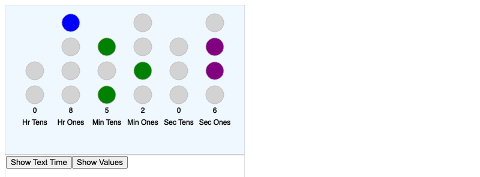

    Interactive p5.js simulation displaying current time in binary format using vertical LED columns

-   **[Binary Number](./binary-number/index.md)**

    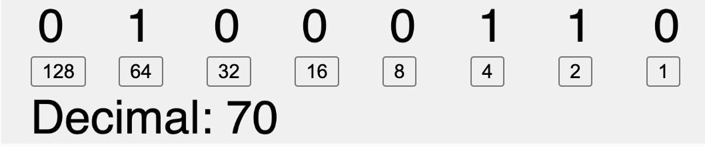

    Interactive p5.js simulation for learning binary numbers with toggle buttons and decimal conversion display

-   **[Bounding Box and Partial Update](./bounding-box-partial-update/index.md)**

    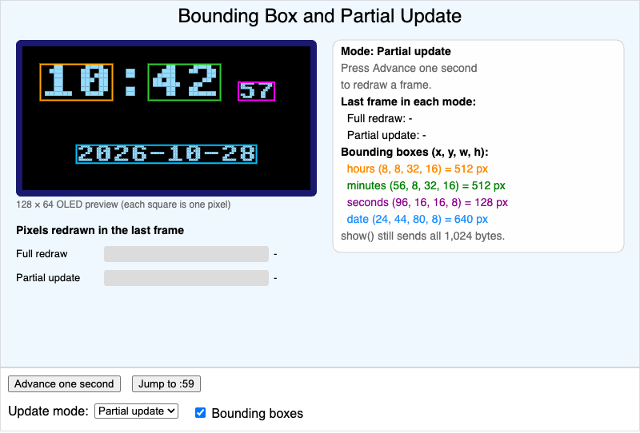

    Compare a full redraw with a partial update on an OLED clock by counting the pixels each one redraws when the seconds change.

-   **[Breadboard Connectivity Explorer](./breadboard-connectivity/index.md)**

    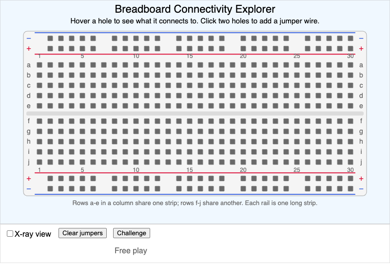

    Hover over any hole of a half-size breadboard to light up every hole it is connected to, add jumper wires, peek at the hidden metal strips with X-ray view, and test yourself in Challenge mode.

-   **[Bus Speed Race](./bus-speed-race/index.md)**

    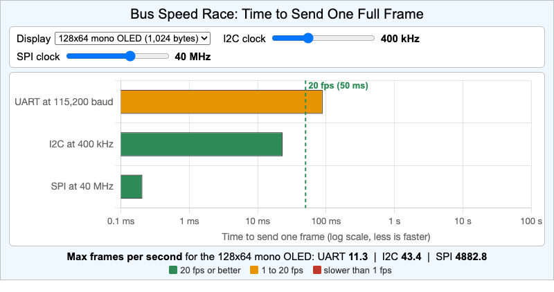

    Compare how long UART, I2C and SPI take to send one full screen of pixels to three different displays, on a logarithmic time axis.

-   **[Button Bounce Oscilloscope](./button-bounce-scope/index.md)**

    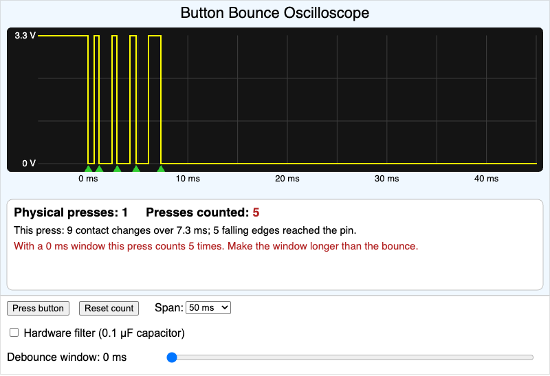

    A single-shot oscilloscope captures contact bounce on every press; adjust the debounce window and a 0.1 uF hardware filter until one press counts once.

-   **[Byte Bit Explorer](./byte-bit-explorer/index.md)**

    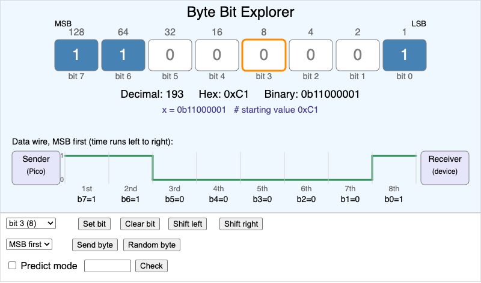

    Toggle the eight bits of a byte, apply set, clear and shift operations, predict the result, and watch the byte go onto a wire MSB-first or LSB-first.

-   **[Clock Architecture Explorer](./clock-architecture-explorer/index.md)**

    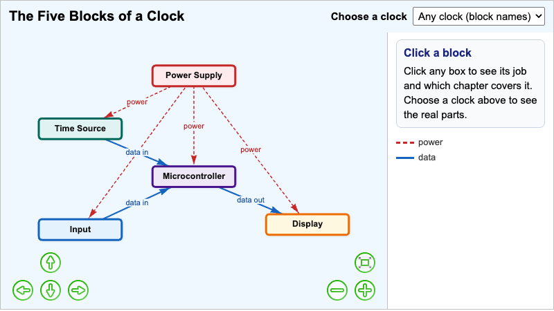

    A block diagram of the five parts every clock needs (power supply, microcontroller, time source, display, and input) that relabels each block with real parts for three different clocks.

-   **[Clock Decomposition Explorer](./clock-decomposition-explorer/index.md)**

    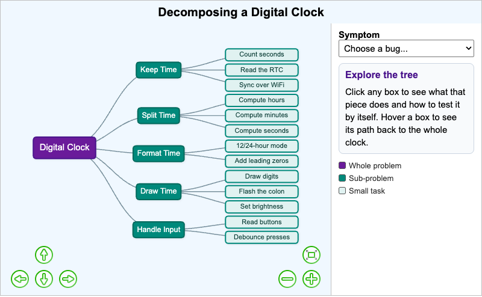

    Explore a tree that breaks a digital clock into five sub-problems and thirteen small tasks, then pick a bug symptom and see which task is the most likely suspect.

-   **[Clock Mode State Machine](./clock-mode-state-machine/index.md)**

    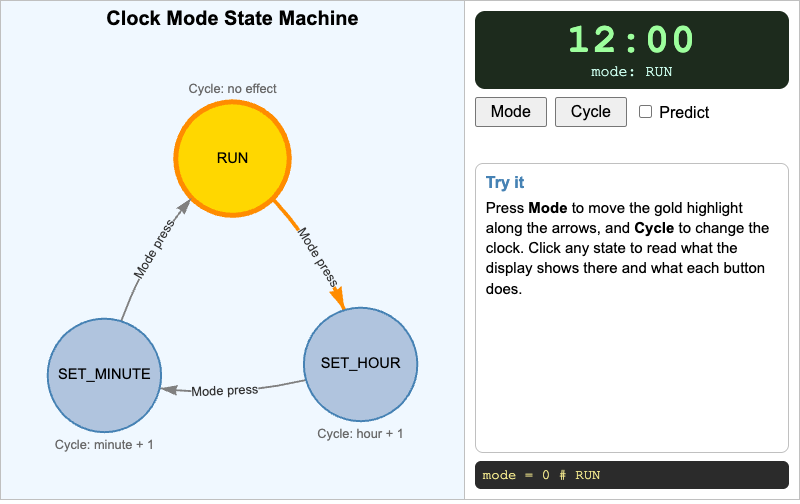

    A three-state clock (RUN, SET_HOUR, SET_MINUTE) driven by Mode and Cycle buttons, with a mock display, clickable state descriptions and a predict-the-next-state mode.

-   **[Crystal Divider MicroSim](./crystal-divider/index.md)**

    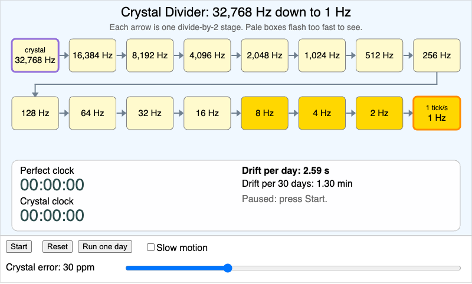

    Watch a 32,768 Hz quartz crystal get divided by two fifteen times into a 1 Hz tick, then see how a parts-per-million error makes a clock drift each day.

-   **[Data Type Sorter](./data-type-sorter/index.md)**

    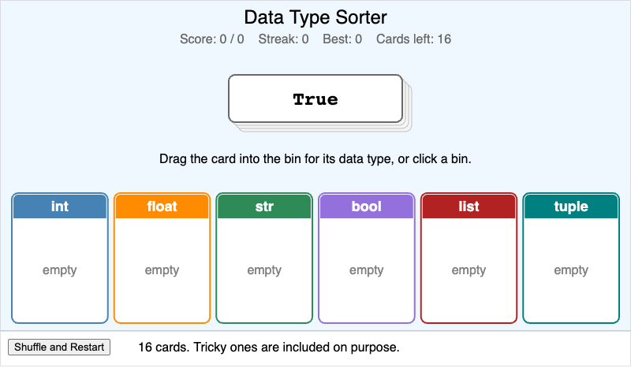

    Drag Python value cards such as 3.0, "42" and (2026, 9, 28) into bins for int, float, str, bool, list and tuple, with hints for wrong answers.

-   **[Design Decision Matrix](./design-decision-matrix/index.md)**

    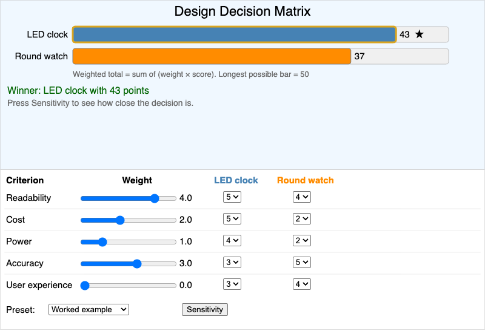

    Weight criteria and score up to four clock designs in a decision matrix, see the weighted totals and the winner, and test how sensitive the choice is to each weight.

-   **[Digit Scaling Explorer](./digit-scaling-explorer/index.md)**

    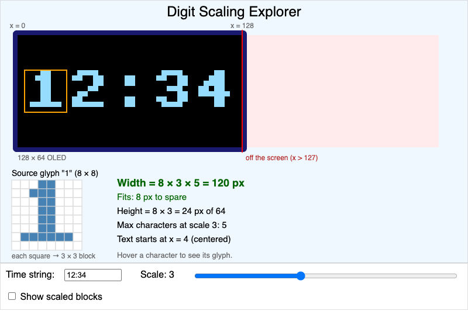

    Scale an 8 by 8 font up to 6 times on a 128 by 64 OLED preview and see when the text becomes too wide for the screen.

-   **[Drift Calculator](./clock-drift-calculator/index.md)**

    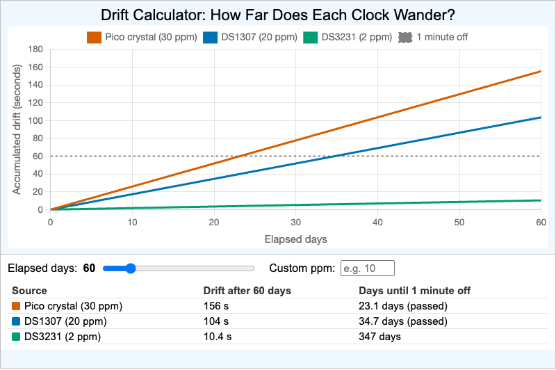

    A Chart.js line chart of accumulated drift versus days for a Pico crystal, a DS1307, a DS3231, and a custom ppm value, with the days until each clock is one minute off.

-   **[DS3231 Register Map](./ds3231-register-map/index.md)**

    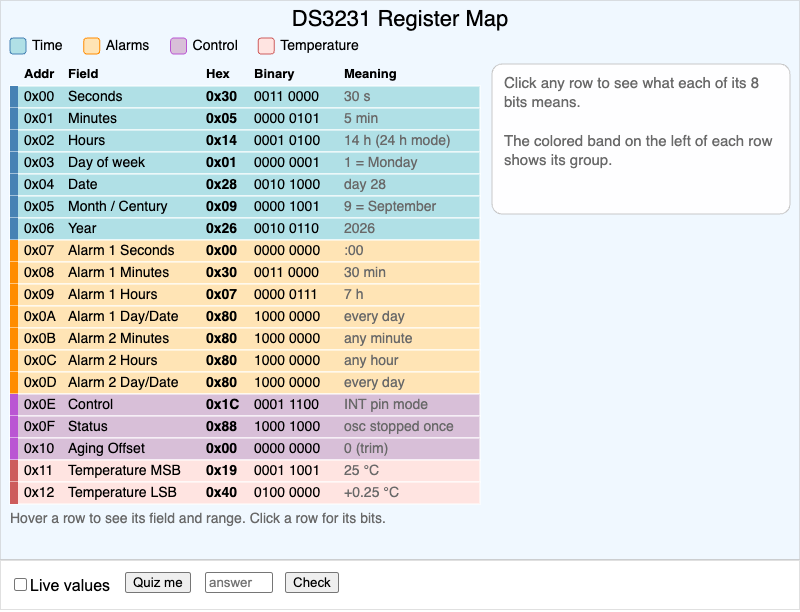

    An interactive map of the DS3231 real-time clock registers 0x00 to 0x12 showing each byte in hex, binary, and decoded form, with bit-field details, live BCD values, and a decoding quiz.

-   **[E-Paper Refresh Lab](./epaper-refresh-lab/index.md)**

    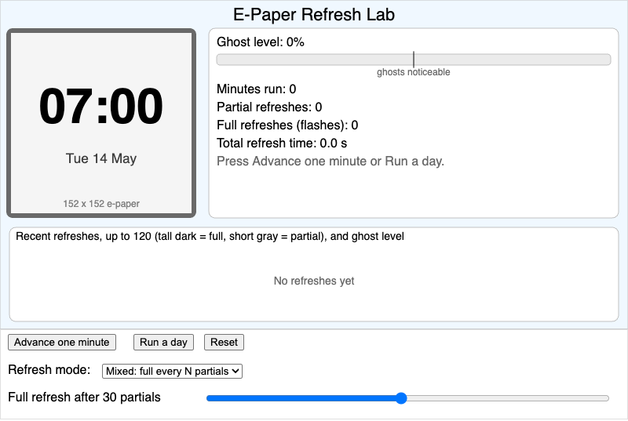

    Compare always-full, always-partial and mixed refresh schedules on an e-paper clock, and watch the trade-off between refresh time, screen flashes and ghosting.

-   **[Font Pipeline](./font-pipeline/index.md)**

    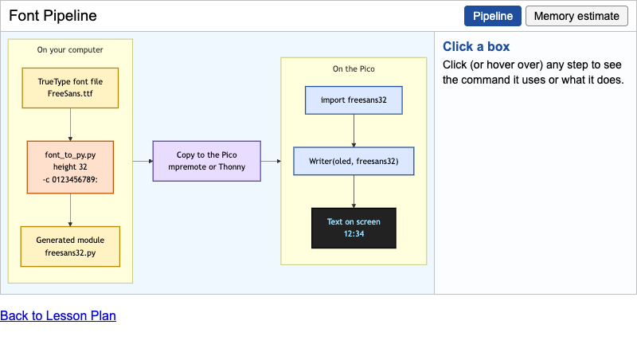

    Follow the steps from a TrueType font on your computer to large text on the OLED, and estimate how much memory a font module needs.

-   **[Four-Digit Digital Clock](./4-digits/index.md)**

    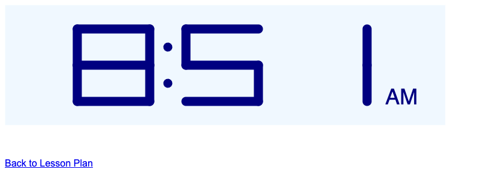

    An interactive p5.js simulation displaying current time using four seven-segment digits with AM/PM indicator

-   **[Framebuffer Pipeline](./framebuffer-pipeline/index.md)**

    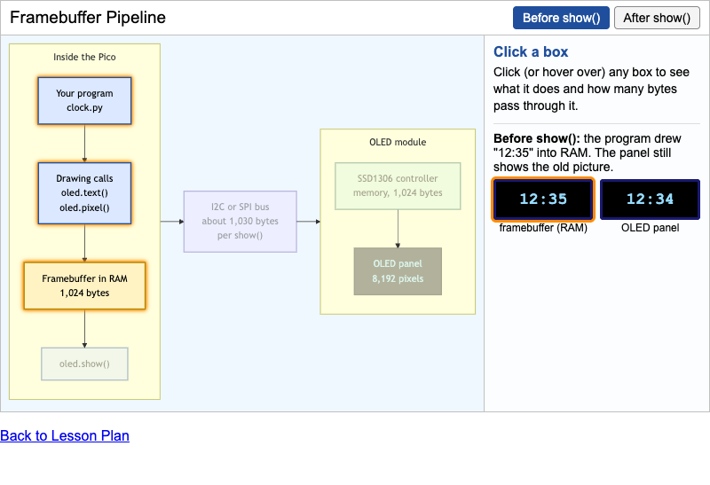

    Follow the path from a drawing call to lit pixels on an OLED, and compare the state before and after show().

-   **[Function Machine](./function-machine/index.md)**

    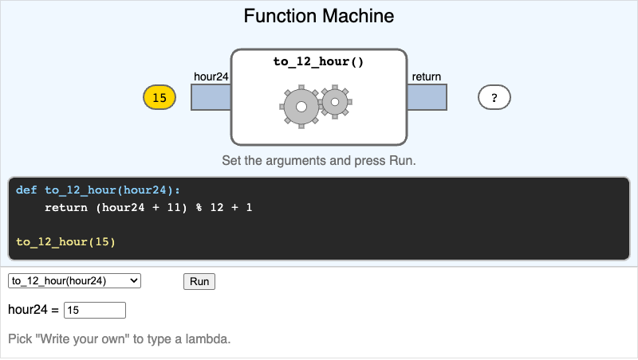

    Functions drawn as machines: argument tokens enter chutes named after the parameters and the return value comes out, including a write-your-own lambda.

-   **[Greeting Decision Path](./greeting-decision-path/index.md)**

    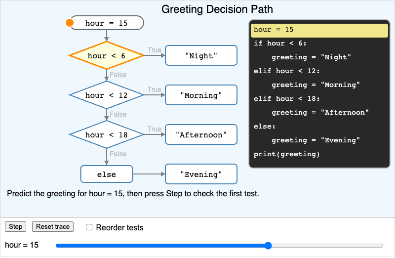

    Trace an if/elif/else chain that picks a greeting from the hour, one test at a time, and see how reordering the tests changes the answer.

-   **[HSV Color Wheel](./hsv-color-wheel/index.md)**

    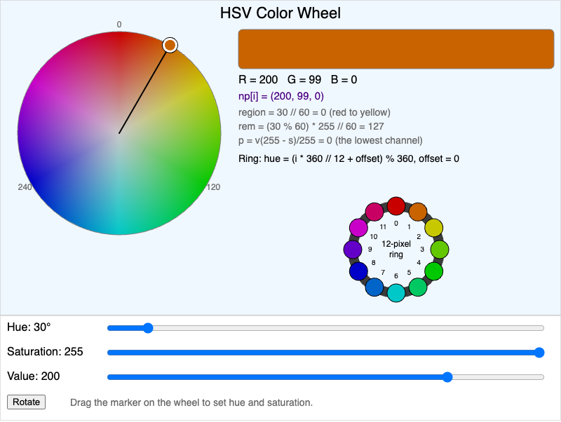

    Explore hue, saturation, and value on a color wheel with a draggable marker, see the RGB values from the same integer hsv_to_rgb function used on the Pico, and watch a 12-pixel virtual NeoPixel ring show and rotate the rainbow.

-   **[Hysteresis Demonstrator](./hysteresis-demonstrator/index.md)**

    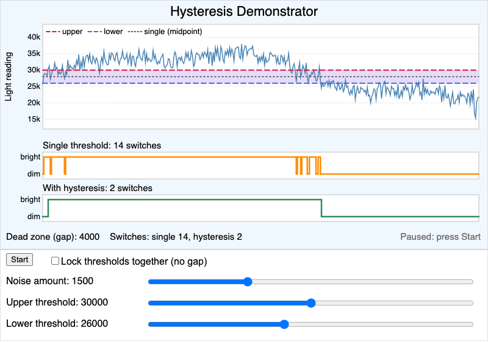

    Compare a single threshold with a two-threshold dead zone on a noisy light reading, and count how often each output switches.

-   **[I2C Conversation Animator](./i2c-conversation-animator/index.md)**

    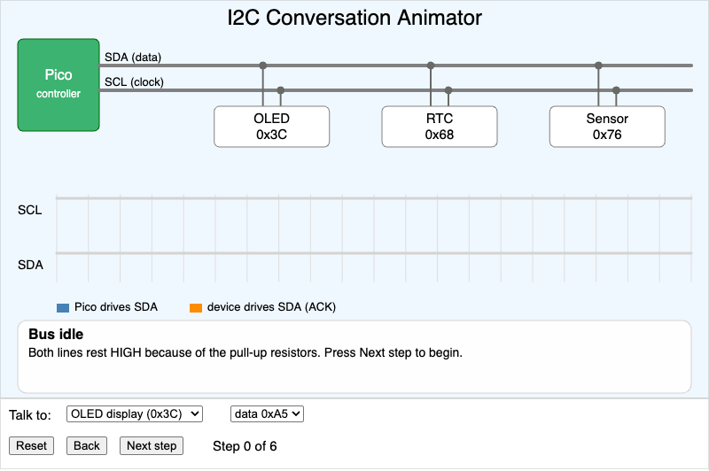

    Step through one I2C write transaction - START, address and write bit, ACK, data byte, ACK, STOP - and see the SDA and SCL waveforms for each part.

-   **[LDR Light Sensor Lab](./ldr-light-sensor-lab/index.md)**

    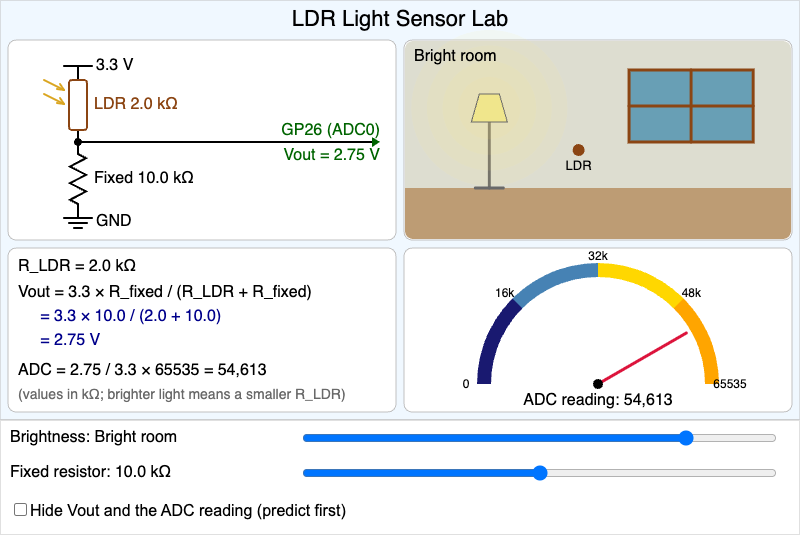

    Use the voltage divider formula to predict the ADC reading of a light-dependent resistor as the room brightness and the fixed resistor change.

-   **[Learning Graph Viewer](./learning-graph/index.md)**

    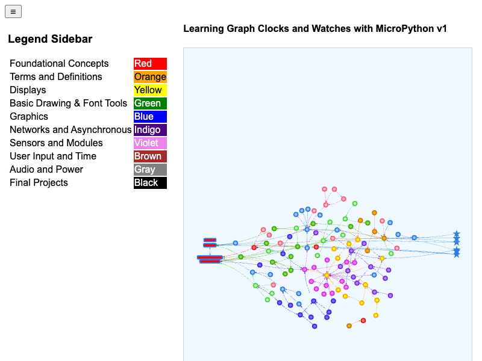

    Interactive vis-network visualization of the learning graph for Clocks and Watches with MicroPython course concepts

-   **[LED Resistor Calculator](./led-resistor-calculator/index.md)**

    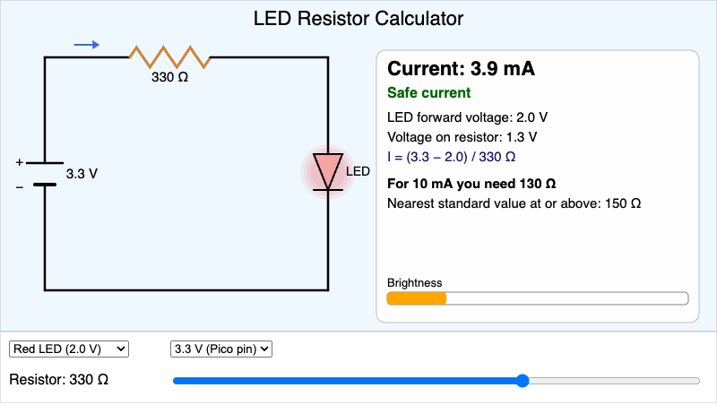

    Choose an LED color, a 3.3 V or 5 V supply, and a standard resistor to see the LED current, its brightness, a warning above 20 mA, and the resistor you would need for 10 mA.

-   **[Logic Analyzer Trace Reader](./logic-analyzer-trace-reader/index.md)**

    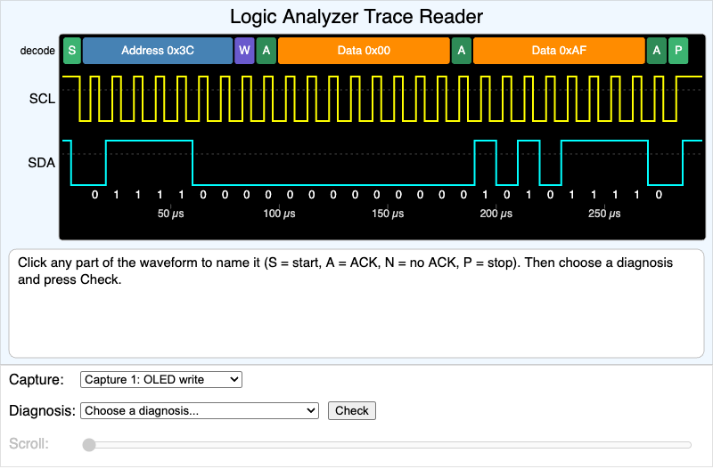

    Read captured I2C and button waveforms on a logic analyzer, click each part to decode it, and diagnose a missing acknowledgment, weak pull-ups or contact bounce.

-   **[NeoPixel Digit Layout](./neopixel-digit-layout/index.md)**

    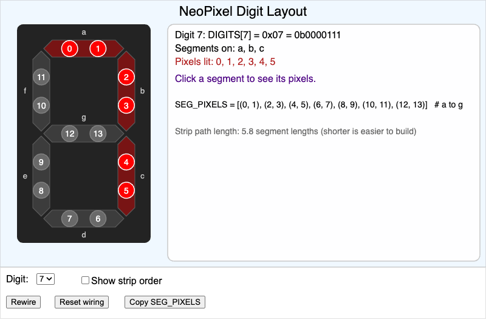

    A seven-segment digit built from a 14-pixel NeoPixel strip. Click segments to see their pixels, choose a digit to see which pixels light, show the strip's path, design your own wiring order, and copy it as a Python SEG_PIXELS list.

-   **[NeoPixel Power Budget](./neopixel-power-budget/index.md)**

    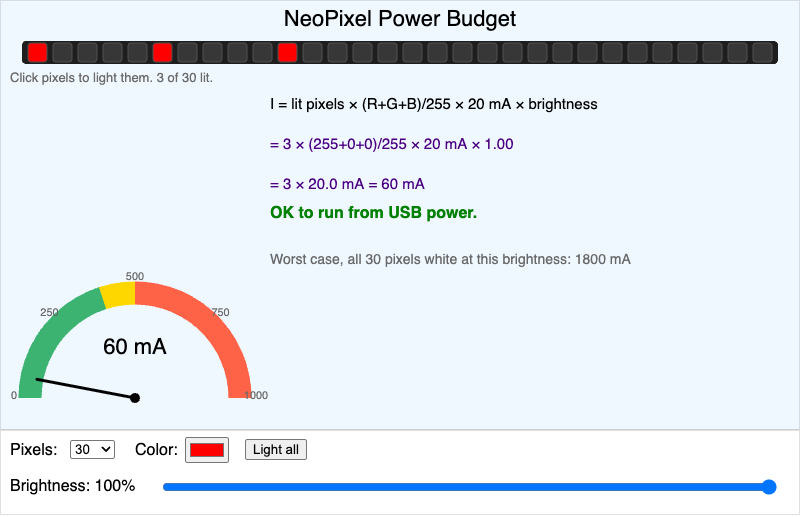

    Light pixels on a virtual NeoPixel strip, choose the color, length, and brightness, and watch a gauge compare the total current with the 500 mA USB limit, with the power formula shown with the numbers filled in.

-   **[NTP Stratum Hierarchy](./ntp-stratum-hierarchy/index.md)**

    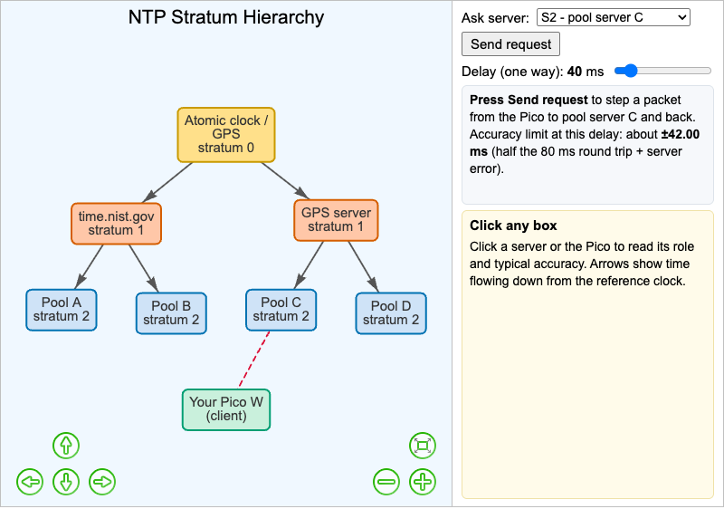

    A vis-network tree showing how time flows from atomic clocks through stratum 1 and stratum 2 NTP servers to a Pico W, with a step-by-step request and reply that shows the four NTP timestamps and how network delay limits accuracy.

-   **[NTP Sync Flow](./ntp-sync-flow/index.md)**

    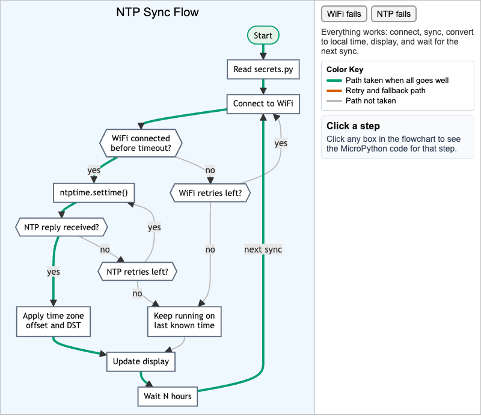

    A Mermaid flowchart of a Pico W time sync, from reading secrets.py to waiting for the next sync, with clickable steps that show their MicroPython code and toggles that light up the WiFi and NTP retry paths.

-   **[Ohm's Law Explorer](./ohms-law-explorer/index.md)**

    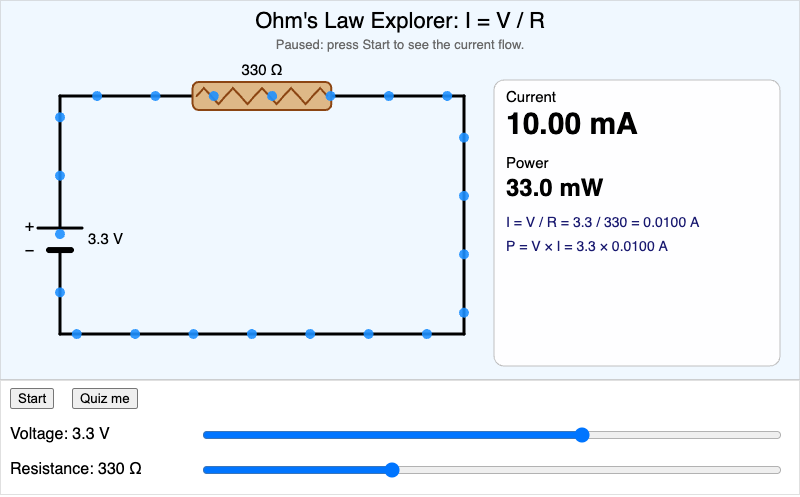

    Change the voltage and resistance of a simple loop circuit to see Ohm's Law at work: live current and power readouts, moving dots that speed up with current, and a quiz that asks you to calculate the current.

-   **[Pico Board Explorer](./pico-board-explorer/index.md)**

    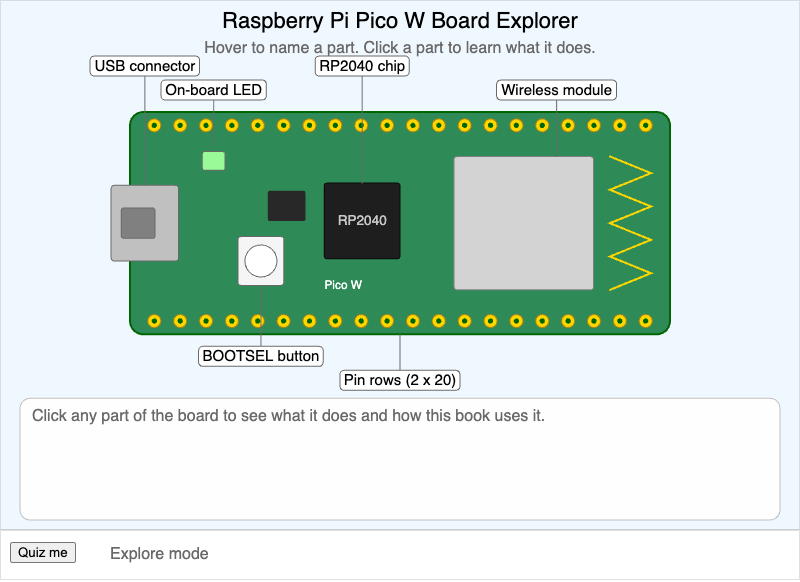

    Hover and click the main parts of a Raspberry Pi Pico W drawing to learn what each one does, then take a quiz that hides the labels and tracks the parts you missed.

-   **[Pico Pinout Explorer](./pico-pinout-explorer/index.md)**

    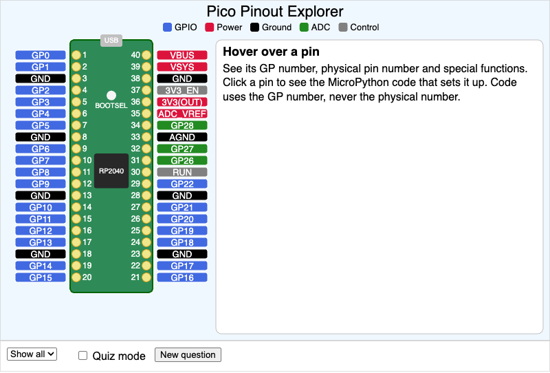

    An interactive Raspberry Pi Pico pinout: hover a pin for its GP number, physical number and functions, click it for MicroPython code, filter by bus, and quiz yourself.

-   **[Pico Startup Sequence](./pico-startup-sequence/index.md)**

    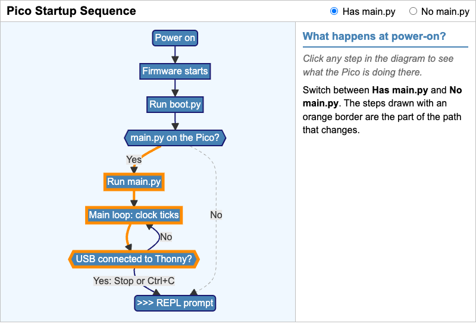

    A clickable flowchart of what the Pico does from power-on to a running clock, with a toggle that shows how the path changes when main.py is missing.

-   **[Pixel Grid Sketchpad](./pixel-grid-sketchpad/index.md)**

    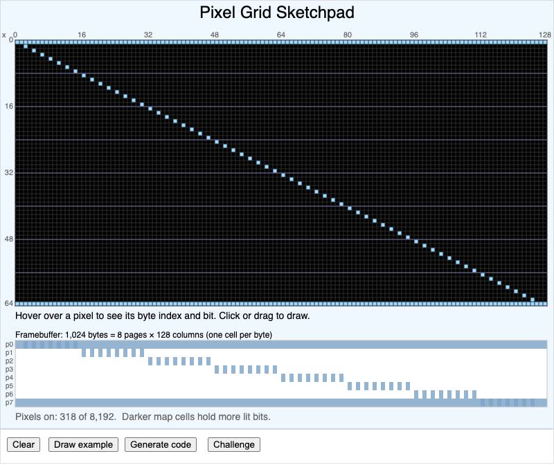

    Draw on a 128 by 64 OLED pixel grid and see which of the 1,024 framebuffer bytes and which bit stores each pixel.

-   **[Polar to Screen Converter](./polar-to-screen/index.md)**

    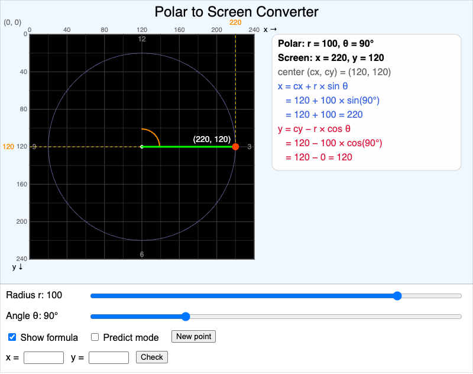

    Convert a radius and a clockwise clock angle into pixel coordinates on a 240 by 240 screen, and practice predicting x and y.

-   **[Pull-Up Button Lab](./pull-up-button-lab/index.md)**

    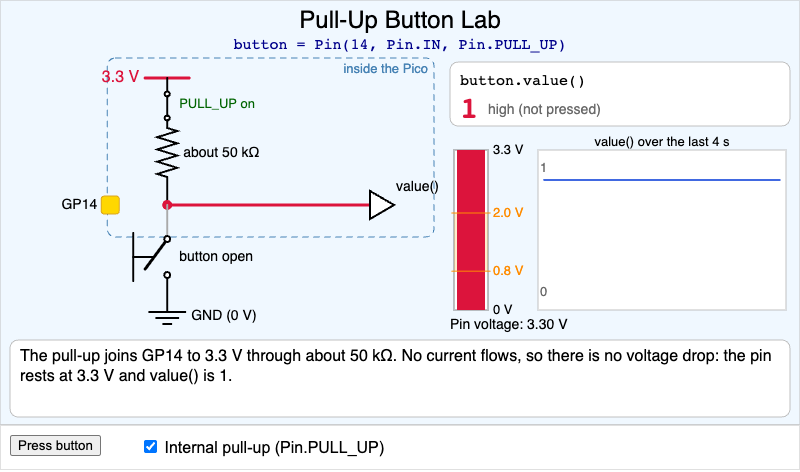

    A GP14 button circuit with the internal pull-up resistor: toggle the button and the pull-up to see the pin voltage, value() and a floating input.

-   **[PWM Tone Lab](./pwm-tone-lab/index.md)**

    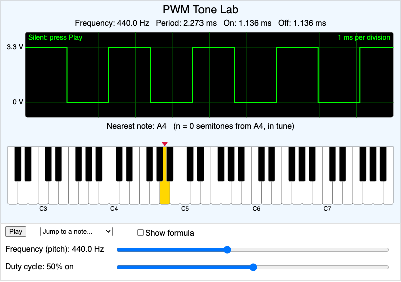

    Change the frequency and duty cycle of a PWM square wave, see it on an oscilloscope and a piano keyboard, and hear it through the browser.

-   **[Quadrature Encoder Simulator](./quadrature-encoder-sim/index.md)**

    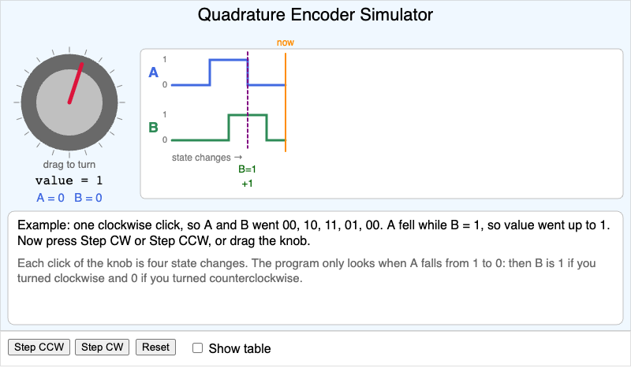

    Turn a rotary encoder knob one step at a time and watch the A and B signals, with each falling edge of A marked by the value of B that sets the direction.

-   **[Resistor Color Code Decoder](./resistor-color-decoder/index.md)**

    

    Click the bands of a large four-band resistor to change their colors and read its value, then quiz yourself by reading random resistors or setting the bands to match a value.

-   **[Resolution and Memory Calculator](./resolution-memory-calculator/index.md)**

    

    Calculate the framebuffer size of five displays and a custom one, and judge whether each fits in the Pico's 264 KB of RAM.

-   **[RGB565 Color Mixer](./rgb565-color-mixer/index.md)**

    

    Mix a color with red, green, and blue sliders and see it packed into the 16-bit RGB565 format, with the 5-6-5 bit groups, the hex value, the color565() call, the detail lost, and the banding in a gradient.

-   **[Sampling Rate Explorer](./sampling-rate-explorer/index.md)**

    

    Sample a sine wave at different rates and bit depths to see the Nyquist limit, aliasing, and the bytes per second each choice costs.

-   **[Schematic Symbol Matcher](./schematic-symbol-matcher/index.md)**

    

    Click the hidden symbols in an LED circuit schematic to reveal each part, match drawings of real parts to their symbols, and trace the current from pin GP15 to ground.

-   **[Seconds-to-Clock Flowchart](./seconds-to-clock-flowchart/index.md)**

    

    Step a number of seconds since midnight through a six-box flowchart that uses whole-number division and remainders to produce an hours:minutes:seconds clock reading.

-   **[Sense-Think-Act Clock Sorter](./sense-think-act-clock/index.md)**

    

    Drag eight clock parts into Sensors, Microcontroller, and Actuators columns, get a hint for every wrong drop, then step one signal through the sense-think-act loop.

-   **[Seven-Segment Display](./seven-segment-display/index.md)**

    

    Interactive p5.js simulation demonstrating how seven-segment displays work with individual segment control

-   **[Shift Register](./shift-register/index.md)**

    

    Interactive p5.js simulation of a 74HC594 shift register demonstrating serial-to-parallel data conversion

-   **[Sleep vs Ticks Timeline](./sleep-vs-ticks/index.md)**

    

    Two timelines compare a blocking sleep(1) loop with a non-blocking ticks_diff() loop and measure how long each takes to notice a button press.

-   **[Stopwatch](./stopwatch/index.md)**

    

    Interactive p5.js stopwatch simulation with start/stop and reset controls, displaying time in MM:SS.mmm format

-   **[Sync Interval Calculator](./sync-interval-calculator/index.md)**

    

    A Chart.js sawtooth chart of clock error over three days that grows between NTP syncs and drops to zero at each sync, with sliders for drift and sync interval.

-   **[Thonny Window Tour](./thonny-window-tour/index.md)**

    

    A clickable mockup of the Thonny IDE with numbered hotspots for the interpreter selector, editor, Run and Stop buttons, Shell, and the two Files panes, plus a quiz mode.

-   **[Tilt and Step Explorer](./tilt-step-explorer/index.md)**

    

    Drag a 3D watch to see gravity move between the accelerometer's x, y and z axes, then tune a step counter's threshold and minimum time between steps on a simulated walk.

-   **[Time Tuple Explorer](./time-tuple-explorer/index.md)**

    

    The eight fields of time.localtime() as labeled boxes filled from your clock: click for an index, drag for a slice like now[3:6], or quiz yourself on the field order.

-   **[Timezone Converter](./timezone-converter/index.md)**

    

    Convert UTC to local time for seven time zones using integer second arithmetic, with a world map of time-zone bands, a DST toggle, highlighted date rollovers, and a Predict mode.

-   **[TM1637 Wiring Diagram](./tm1637-wiring/index.md)**

    

    Connect the four pins of a TM1637 display module to the correct Raspberry Pi Pico pins; correct wires lock in and the display lights up 12:34.

-   **[Troubleshooting Decision Tree](./troubleshooting-decision-tree/index.md)**

    

    Walk a clickable troubleshooting tree for Pico clocks: pick a symptom, answer yes or no questions, and reach a likely cause, the test to run and the chapter to review.

-   **[Unit Circle Explorer](./unit-circle-explorer/index.md)**

    

    See sine and cosine as the vertical and horizontal parts of a point on a circle of radius 1, with matching bars and graphs.

-   **[Variable Box Visualizer](./variable-box-visualizer/index.md)**

    

    Step through short Python programs one assignment at a time and predict each variable's new value before the line runs.

-   **[Voltage Divider Lab](./voltage-divider-lab/index.md)**

    

    Adjust the input voltage and two resistors of a voltage divider, watch a bar-graph voltmeter show the output, and judge whether it is safe for a 3.3 V Pico pin.

-   **[Weather Station Layout](./weather-station-layout/index.md)**

    

    Design a 152 by 152 pixel e-paper weather display by dragging and resizing panels, choose each panel's update schedule, and simulate a day to count refreshes, WiFi connections and battery life.

-   **[Wrap-Around Dial](./wrap-around-dial/index.md)**

    

    A clock-style dial for 12, 24 or 60 positions shows (x + step) % n step by step, including how Python wraps negative numbers.

